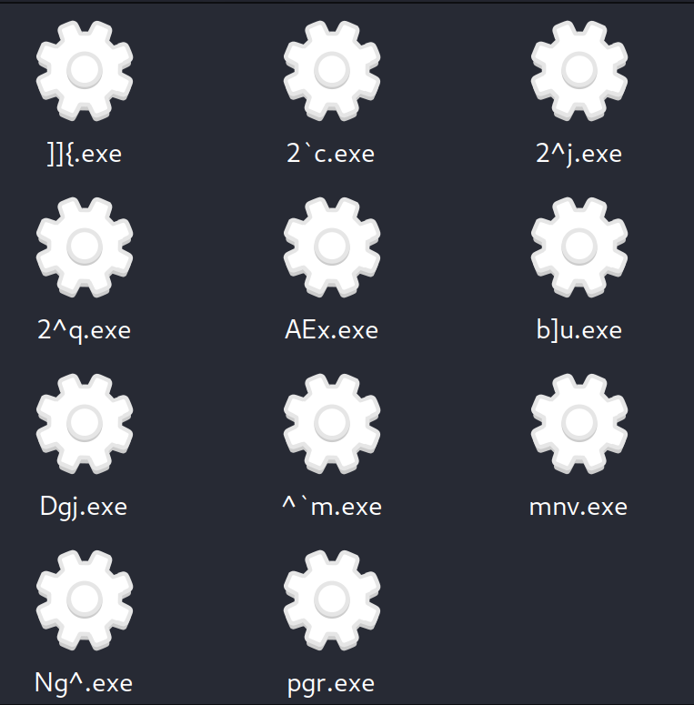
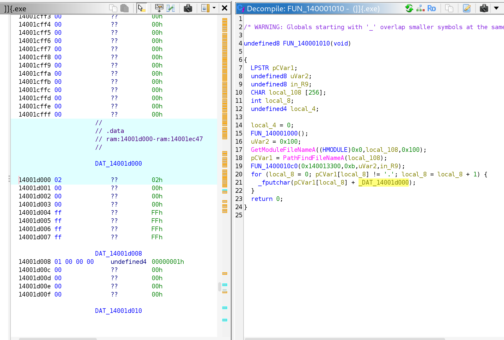
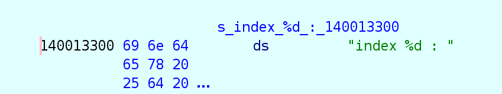
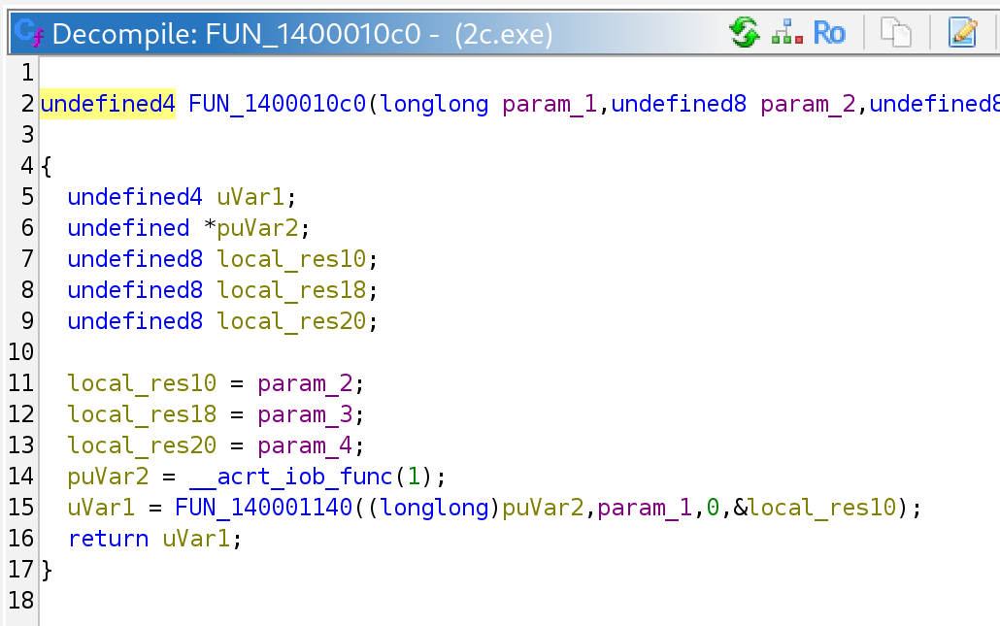
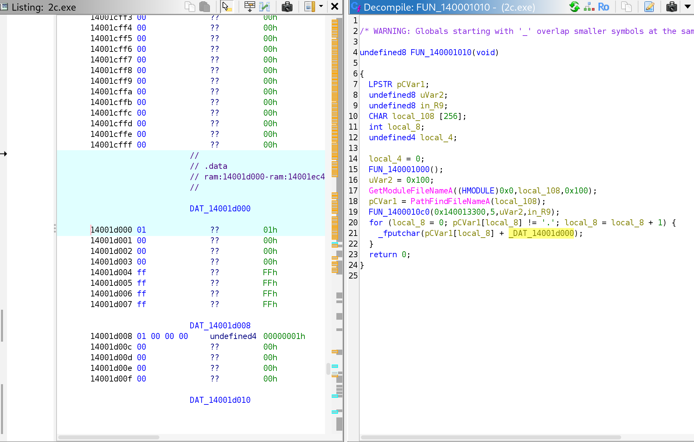

# [DreamHack] What is your name? - Reversing

## 1. 문제 개요

* **문제 링크:** [DreamHack - What is your name?](https://dreamhack.io/wargame/challenges/252)

* **분야:** Reversing

* **목표:** 이름이 제각각인 11개의 Windows PE 실행 파일을 분석하여, 각 파일이 출력하는 플래그 조각의 생성 규칙과 순서를 파악하고 전체 플래그를 복원.

## 2. 취약점 분석
11개 파일 모두 동일한 main 로직을 가지며, `GetModuleFileNameA`와 `PathFindFileNameA`로 자기 자신의 파일명을 가져온 뒤 printf 래퍼(`FUN_1400010c0`)로 `"index %d : "`와 인덱스 숫자를 출력하고, 파일명의 `.` 직전까지 각 문자에 `.data` 섹션 시작 주소(`DAT_14001d000`)의 정수값을 더해 한 글자씩 출력하는 구조. 파일마다 다른 값은 printf에 전달되는 인덱스 즉시값과 `DAT_14001d000`의 값 두 가지뿐임.

```c
// [main (FUN_140001010)] 파일명 기반 조각 출력 로직
// ... (중략) ...
GetModuleFileNameA((HMODULE)0x0,local_108,0x100);
pCVar1 = PathFindFileNameA(local_108);
FUN_1400010c0(0x140013300,0xb,uVar2,in_R9);
for (local_8 = 0; pCVar1[local_8] != '.'; local_8 = local_8 + 1) {
  _fputchar(pCVar1[local_8] + _DAT_14001d000);
}
return 0;
```

```c
// [FUN_1400010c0] printf 래퍼
puVar2 = __acrt_iob_func(1);
uVar1 = FUN_140001140((longlong)puVar2,param_1,0,&local_res10);
return uVar1;
```

```
// [0x140013300] 포맷 문자열
140013300  "index %d : "

// [.data] DAT_14001d000 (]]{.exe)
14001d000  02 00 00 00
```

* **분석 결론:** 각 실행 파일은 전체 플래그 중 한 조각을 담당하며, 조각 내용은 "파일명(확장자 제외) 각 문자 + 파일별 상수"의 단순 치환으로, 조각의 순서는 printf에 전달되는 인덱스로 결정되는 구조. 두 값 모두 바이너리에 정적으로 하드코딩되어 있어, 파일을 실행하지 않고도 파일당 인덱스와 상수만 확인하면 전체 플래그를 복원할 수 있는 구조로 판단.

## 3. 공격 수행

1. 문제 파일 압축 해제 후 특수문자가 섞인 이름의 실행 파일 11개 확인.



2. Ghidra로 `]]{.exe`를 열어 `entry` → `__scrt_common_main_seh` 순으로 진입. Listing의 `Library: Visual Studio 2019 Release` 표기로 MSVC 빌드임을 확인하고, MSVC CRT 패턴(`_get_initial_narrow_environment` → argv/argc 획득 함수 직후 호출, 반환값이 종료 코드로 전달)에 따라 `FUN_140001010`을 main으로 식별. main 내부에서 파일명 처리 루프와 `DAT_14001d000` 덧셈 확인 후, 해당 주소의 값이 `2`임을 확인.



3. main 19번째 줄 호출의 첫 번째 인자 `0x140013300`을 추적하여 `"index %d : "` 포맷 문자열 확인, `FUN_1400010c0`이 stdout(`__acrt_iob_func(1)`)으로 포맷 출력하는 printf 래퍼임을 확인. 이로써 `]]{.exe`는 `index 11 : ` 뒤에 `]]{`의 각 문자 +2 결과인 `__}`를 출력하는 마지막 조각임을 파악.





4. 비교를 위해 ``2`c.exe``를 분석(Ghidra 프로젝트 임포트 시 백틱 문자를 제외하여 `2c.exe`로 표시). main 로직은 동일하고 인덱스가 `5`, `DAT_14001d000` 값이 `1`로, 파일마다 두 값만 다름을 확인.



5. 나머지 9개 파일도 같은 방식으로 Ghidra에서 main의 printf 인덱스 인자와 `DAT_14001d000` 값을 확인하여 기록하고, 파일명(확장자 제외)의 각 문자에 해당 값을 더해 조각 계산.

## 4. 획득 결과
11개 파일의 인덱스·상수·변환 결과를 인덱스 순서로 정렬하여 결합한 결과 전체 플래그 복원.

```
// [파일별 분석 결과]
index  1 : AEx  +3  →  DH{
index  2 : Ng^  +1  →  Oh_
index  3 : Dgj  +2  →  Fil
index  4 : 2^q  +1  →  3_r
index  5 : 2`c  +1  →  3ad
index  6 : ^`m  +1  →  _an
index  7 : b]u  +2  →  d_w
index  8 : pgr  +2  →  rit
index  9 : 2^j  +1  →  3_k
index 10 : mnv  +1  →  now
index 11 : ]]{  +2  →  __}
```

* **FLAG:** `DH{Oh_Fil3_r3ad_and_writ3_know__}`

## 5. 대응 방안
해당 프로그램은 비밀값을 여러 파일에 나누고 파일명에 숨겼으나, 복원에 필요한 모든 정보(파일명, 치환 상수, 순서)가 바이너리와 파일 시스템에 평문 수준으로 노출된 구조. 시큐어 코딩 관점에서 다음과 같은 개선 방안 적용 필요.

* **민감 데이터 하드코딩 금지:** 플래그·키 등 비밀값을 바이너리 상수나 파일명에 분산 저장하지 않고, 서버 측에 보관하여 인증된 요청에만 반환하는 구조로 설계.

* **단순 치환 기반 은닉 지양:** 문자에 고정 상수를 더하는 방식은 상수 하나만 확인하면 즉시 역산되므로 보호 수단으로 볼 수 없음. 클라이언트에 반드시 두어야 하는 값이라면 표준 암호 알고리즘을 사용하고, 키를 바이너리에 함께 넣지 않을 것.

* **외부 조작 가능 입력에 대한 신뢰 금지:** 파일명은 사용자가 자유롭게 변경할 수 있는 값이므로, 프로그램의 핵심 로직이나 비밀값 생성의 근거로 사용하지 않을 것.

## 6. 블루팀 관점 요약
해당 바이너리들은 로컬에서 표준 출력만 수행하며 네트워크 통신이 전혀 없어, 방화벽·IDS 등 네트워크 기반 관제 장비로는 실행 여부조차 식별 불가. 동일 로직의 PE 파일이 다수 존재하고 파일 간 차이가 특정 상수와 즉시값뿐이라는 특징상, 호스트 단 정적 스캔으로 동일 계열 파일을 묶어 식별하는 방식이 유효함. 파일 수가 많은 경우 `.data` 섹션 시작값과 main 내 인덱스 즉시값을 자동으로 읽어 조각을 복원하는 추출 도구를 만들면, 대량 유포된 악성코드 변종에서 설정값을 일괄 추출하는 Config Extractor와 같은 방식으로 분석 시간 단축 가능.

### 6.1. YARA 탐지 룰 (IoC)
정적 분석 과정에서 식별된 하드코딩 포맷 문자열과 파일명 획득 API 조합을 기반으로, 동일 계열 실행 파일을 식별하기 위한 YARA 룰 제안.

```yara
rule Detect_What_Is_Your_Name
{
    strings:
        $s1 = "index %d : " ascii
        $s2 = "GetModuleFileNameA" ascii
        $s3 = "PathFindFileNameA" ascii

    condition:
        uint16(0) == 0x5A4D and all of them
}
```