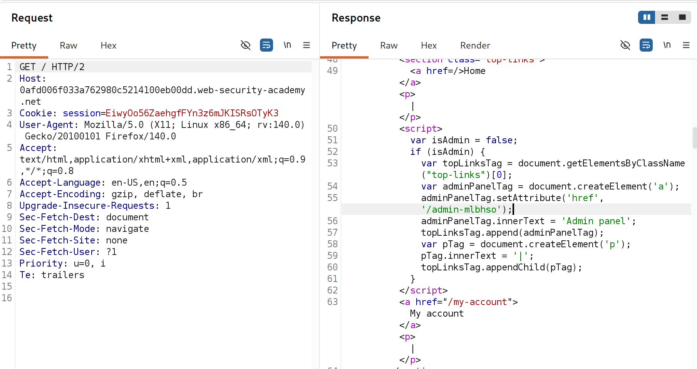
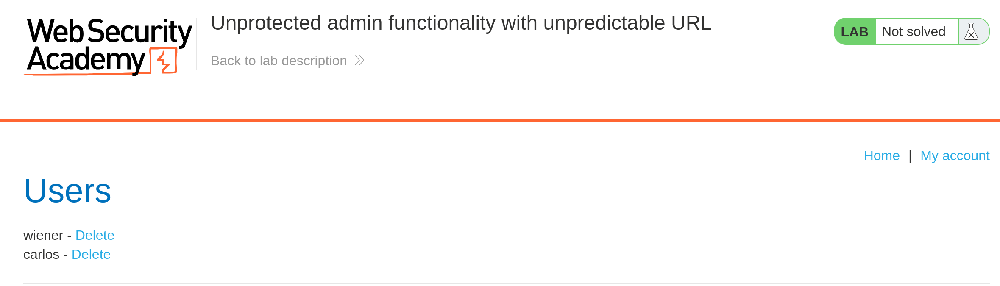
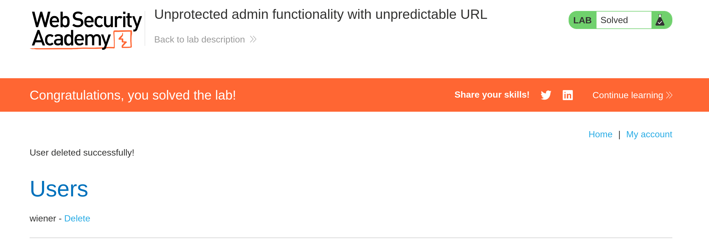

# [PortSwigger] Unprotected Admin Functionality with Unpredictable URL - Web Hacking

## 1. 문제 개요

* **문제 링크:** [Web Security Academy - Unprotected admin functionality with unpredictable URL](https://portswigger.net/web-security/access-control/lab-unprotected-admin-functionality-with-unpredictable-url)

* **분야:** Web

* **목표:** 추측 불가능한 경로에 위치한 관리자 패널의 경로가 애플리케이션 응답에 노출되어 있음. 노출된 경로로 관리자 패널에 인가 없이 접근하고 관리 기능으로 사용자 `carlos`를 삭제하여 Lab 해결

## 2. 취약점 분석
관리자 패널이 추측 불가능한 경로(`/admin-mlbhso`)에 위치하나, 그 경로가 메인 페이지(`GET /`) 응답의 인라인 스크립트에 하드코딩되어 모든 사용자에게 그대로 전달됨. 스크립트는 `isAdmin` 플래그가 참일 때만 관리자 링크를 DOM에 렌더링하지만, 분기 조건과 무관하게 경로 문자열 자체는 응답 본문에 포함되어 노출됨. 서버는 해당 경로 접근 시 세션 권한을 검증하지 않아, 비권한 사용자도 응답 소스에서 경로를 읽어 직접 접근 가능.

```javascript
// [GET / 응답 내 인라인 스크립트] 관리자 패널 경로 하드코딩 및 클라이언트 측 isAdmin 분기
var isAdmin = false;
if (isAdmin) {
    // ... (중략) ...
    var adminPanelTag = document.createElement('a');
    adminPanelTag.setAttribute('href', '/admin-mlbhso');
    // ... (중략) ...
}
```

* **분석 결론:** 관리 기능 엔드포인트에 대한 서버 측 인가 검증 부재와, 추측 불가능한 경로를 전 사용자에게 전달되는 클라이언트 스크립트에 노출한 설계 결함이 결합. `isAdmin` 분기는 화면 렌더링만 제어할 뿐 경로 노출과 서버 접근을 막지 못하므로, 비권한 사용자가 응답 소스에서 경로를 추출해 관리자 패널에 직접 접근 가능. 경로의 추측 불가능성(Security through Obscurity)에만 의존한 보호는 소스 노출로 즉시 무력화됨.

## 3. 공격 수행

1. 관리자 패널 경로를 찾기 위해 메인 페이지(`GET /`) 응답을 Burp로 확인. 응답 본문의 인라인 스크립트 `isAdmin` 분기 내부에 관리자 패널 경로 `/admin-mlbhso`가 하드코딩되어 노출됨을 확인.



2. 노출된 `/admin-mlbhso` 경로로 직접 접근. 관리자 권한 없이도 관리자 패널이 그대로 로드되며, 등록된 사용자 목록과 각 사용자에 대한 Delete 기능이 노출됨을 확인.



3. 대상 사용자 `carlos`의 Delete를 실행. "User deleted successfully!" 및 "Congratulations, you solved the lab!" 노출로 Lab 해결을 확인(Render).



## 4. 획득 결과
메인 페이지 응답의 인라인 스크립트에 하드코딩된 관리자 패널 경로(`/admin-mlbhso`)를 단서로 획득하고, 서버 측 접근 통제 부재를 이용해 비권한 상태로 관리자 패널에 직접 접근. 관리 기능인 사용자 삭제로 `carlos`를 삭제하여 Lab 해결.

## 5. 대응 방안
추측 불가능한 경로나 클라이언트 분기가 아니라, 관리 기능 자체에 대한 서버 측 인가 검증을 강제할 필요.

* **서버 측 인가 검증 강제:** 관리자 엔드포인트(`/admin-mlbhso` 등)마다 서버에서 세션의 관리자 권한(role)을 검증하고, 미충족 시 기능 수행 이전에 차단. 경로의 추측 난이도와 무관하게 적용.

* **클라이언트 코드 내 민감 경로 노출 제거:** 관리자 전용 경로·엔드포인트를 전 사용자에게 전달되는 클라이언트 스크립트에 포함하지 않음. 관리자 UI는 서버가 권한을 확인한 뒤에만 경로를 포함해 렌더링.

* **클라이언트 측 권한 분기 비신뢰:** `isAdmin` 등 클라이언트 플래그에 의존한 분기는 화면 제어용일 뿐 보안 경계가 아니므로, 실제 권한 결정은 서버에서 수행.

* **기본 거부(Deny by Default) 적용:** 관리 기능 접근을 허용 목록 기반으로 설계해 인가된 주체만 접근하도록 하고, 그 외 요청은 기본 거부.

## 6. 블루팀 관점 요약
보안관제 및 침해사고 대응(IR) 관점에서, 노출된 비추측 관리자 경로로의 접근은 비인가 세션이 관리자 경로·기능을 직접 호출하는 흐름으로 식별 가능.

* **WAF 및 웹 서버 로그 분석:** 관리자 권한 없는(또는 비로그인) 세션이 `/admin-mlbhso` 같은 관리자 경로에 접근하는 요청과 사용자 삭제 등 관리 기능 호출을 상관 분석해 탐지. 경로가 세션별로 무작위라 네트워크 시그니처보다, "비관리자 세션의 관리자 엔드포인트 접근"을 로그·애플리케이션 레벨에서 상관 분석하는 쪽이 더 신뢰도 높음. 정상 사용자 트래픽에는 해당 경로 접근이 존재하지 않음.

* **침해사고 대응(IR) 시나리오:** 관리자 경로 접근 로그에서 출처 IP·세션·User-Agent를 식별하고, 실제 수행된 관리 작업(삭제된 계정 등)의 범위를 산정. 비인가 접근 세션을 침해 지표(IoC)로 격리하고, 관리자 엔드포인트의 인가 검증 부재와 클라이언트 경로 노출을 조치 대상으로 분류.

* **네트워크 기반 탐지 룰 제안 (Snort 3):**

  - 노출된 관리자 경로에 대한 외부 직접 접근 탐지. 경로가 인스턴스별로 달라 고정 패턴 매칭은 한계가 있으므로, 해당 인스턴스 경로에 한정한 보조 탐지로 운용.

  - `alert http $EXTERNAL_NET any -> $HTTP_SERVERS any (msg:"[Web] Unauthorized Admin Panel Access (Unpredictable URL)"; flow:to_server,established; http_uri; content:"/admin-mlbhso"; sid:1000030; rev:1;)`

  - 관리자 패널을 통한 사용자 삭제 등 관리 기능 호출 탐지.

  - `alert http $EXTERNAL_NET any -> $HTTP_SERVERS any (msg:"[Web] Admin Panel User Deletion Request"; flow:to_server,established; http_uri; content:"/admin-mlbhso/delete"; sid:1000031; rev:1;)`