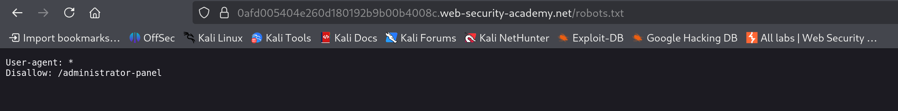
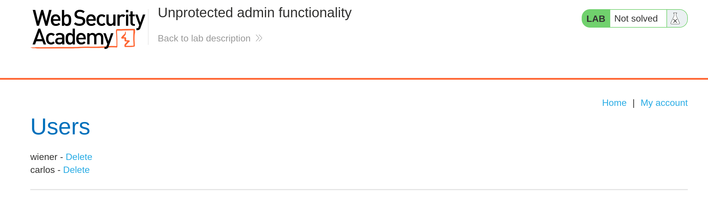
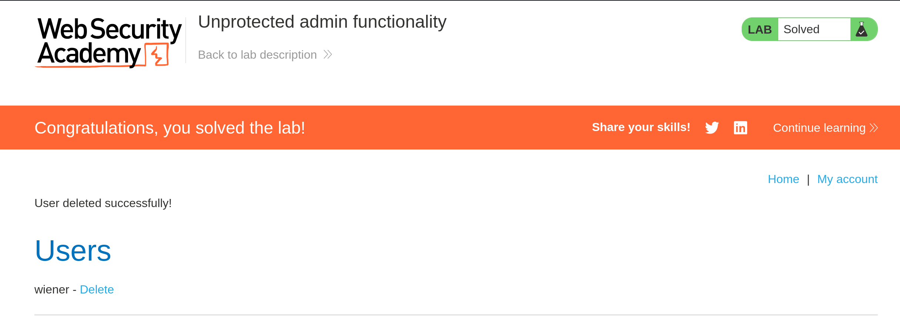

# [PortSwigger] Unprotected Admin Functionality - Web Hacking

## 1. 문제 개요

* **문제 링크:** [Web Security Academy - Unprotected admin functionality](https://portswigger.net/web-security/access-control/lab-unprotected-admin-functionality)

* **분야:** Web

* **목표:** 관리자 기능에 대한 접근 통제가 없는 애플리케이션에서, `robots.txt`에 노출된 관리자 패널 경로(`/administrator-panel`)에 인가 없이 접근하고 관리 기능으로 사용자 `carlos`를 삭제하여 Lab 해결

## 2. 취약점 분석
소스가 제공되지 않는 접근 통제(Access Control) 취약점으로, 관리자 패널의 노출 경로와 접근 동작을 블랙박스로 관찰해 분석. 애플리케이션은 관리 기능을 담은 `/administrator-panel`을 서버 측 인증·인가 검증으로 보호하지 않고, 경로를 공개하지 않는 것(비노출)에만 의존함. 여기에 더해 `robots.txt`의 `Disallow` 항목에 바로 그 관리자 경로를 기재해, 숨기려던 위치를 스스로 노출함. 해당 경로 접근 시 세션·권한에 대한 서버 측 검증이 없어, 비로그인·비권한 사용자도 경로만 알면 사용자 삭제 등 관리 기능을 그대로 호출할 수 있음.

* **분석 결론:** 관리 기능에 대한 서버 측 인가 검증 부재와 `robots.txt`를 통한 경로 노출이 결합되어, 인증되지 않은 사용자가 관리자 패널에 직접 접근해 관리 기능을 임의 실행할 수 있는 접근 통제 취약점이 성립. 경로 비노출(Security through Obscurity)에만 의존한 보호는 `robots.txt` 한 줄로 즉시 무력화됨.

## 3. 공격 수행

1. 관리 기능의 위치를 찾기 위해 먼저 `/robots.txt`를 확인. `Disallow` 항목에 관리자 패널 경로인 `/administrator-panel`이 그대로 노출됨을 확인.

2. 노출된 `/administrator-panel` 경로로 직접 접근. 로그인·권한 검증 없이 관리자 패널이 그대로 로드되며, 등록된 사용자 목록과 각 사용자에 대한 Delete 기능이 노출됨을 확인.

3. 대상 사용자 `carlos`의 Delete를 실행. "User deleted successfully!" 및 "Congratulations, you solved the lab!" 노출로 Lab 해결을 확인(Render).

## 4. 획득 결과
`robots.txt`에 노출된 관리자 패널 경로를 단서로 `/administrator-panel`에 인가 없이 직접 접근하고, 서버 측 접근 통제 부재를 이용해 관리 기능인 사용자 삭제를 실행. 대상 사용자 `carlos`를 삭제하여 Lab 해결.

## 5. 대응 방안
경로 은닉이 아니라 관리 기능 자체에 대한 서버 측 인가 검증을 강제할 필요.

* **서버 측 인가 검증 강제:** 관리자 엔드포인트(`/administrator-panel` 등)마다 요청 세션의 인증 여부와 관리자 권한(role)을 서버에서 검증하고, 조건 미충족 시 기능 수행 이전에 차단. 경로의 클라이언트 노출 여부와 무관하게 적용.

* **기본 거부(Deny by Default) 적용:** 접근 제어를 허용 목록 기반으로 설계해 명시적으로 인가된 주체만 관리 기능에 접근하도록 하고, 그 외 요청은 기본 거부.

* **중앙 집중식 접근 제어:** 엔드포인트별 개별 구현 대신 공통 미들웨어·필터에서 인가를 일괄 검증해, 특정 관리 기능에서 검증이 누락되는 사각지대를 제거.

* **`robots.txt` 민감 경로 미기재:** `robots.txt`는 접근 통제 수단이 아니므로 관리자 경로 등 민감 경로를 기재하지 않음. 비노출은 보호가 아니며, 실제 보호는 인가 검증으로 수행.

## 6. 블루팀 관점 요약
보안관제 및 침해사고 대응(IR) 관점에서, 관리자 패널 무단 접근은 `robots.txt` 등 정찰성 요청에 이은 비인가 세션의 관리자 경로·기능 접근 흐름으로 식별 가능.

* **WAF 및 웹 서버 로그 분석:** `GET /robots.txt` 조회 직후 동일 출처가 `/administrator-panel`에 접근하는 연쇄, 관리자 권한 없는(또는 비로그인) 세션의 관리자 경로 접근, 사용자 삭제 등 관리 기능 호출 요청을 상관 분석해 탐지. 정상 사용자 트래픽에는 `/administrator-panel` 접근이 존재하지 않음.

* **침해사고 대응(IR) 시나리오:** 관리자 패널 접근 로그에서 출처 IP·세션·User-Agent를 식별하고, 실제 수행된 관리 작업(삭제된 계정 등)의 범위를 산정. 비인가 접근 세션을 침해 지표(IoC)로 격리하고, 관리자 엔드포인트의 인가 검증 부재를 긴급 조치 대상으로 분류.

* **네트워크 기반 탐지 룰 제안 (Snort 3):**

  - 정상 흐름에 없는 관리자 패널 직접 접근 요청 탐지.

  - `alert http $EXTERNAL_NET any -> $HTTP_SERVERS any (msg:"[Web] Unauthorized Admin Panel Access"; flow:to_server,established; http_uri; content:"/administrator-panel"; sid:1000028; rev:1;)`

  - 관리자 패널을 통한 사용자 삭제 등 관리 기능 호출 탐지.

  - `alert http $EXTERNAL_NET any -> $HTTP_SERVERS any (msg:"[Web] Admin Panel User Deletion Request"; flow:to_server,established; http_uri; content:"/administrator-panel/delete"; sid:1000029; rev:1;)`