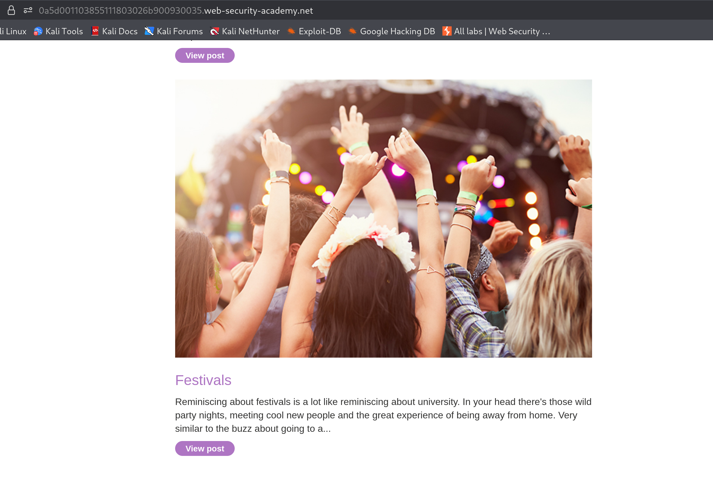
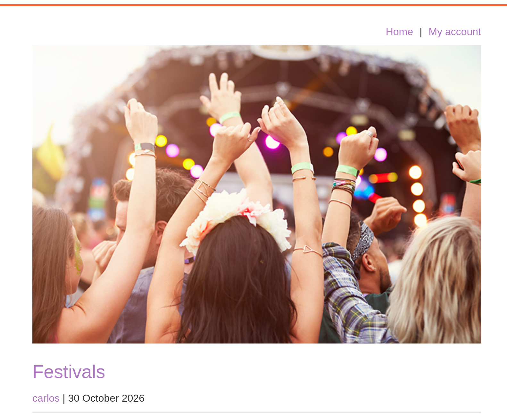
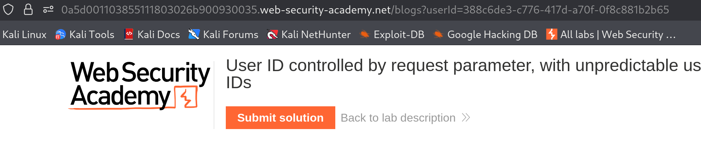
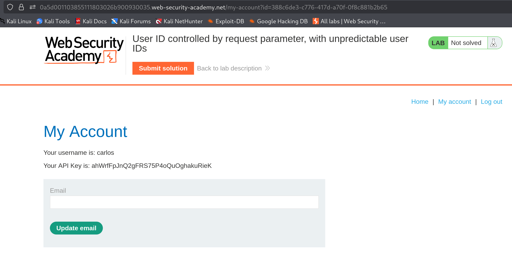
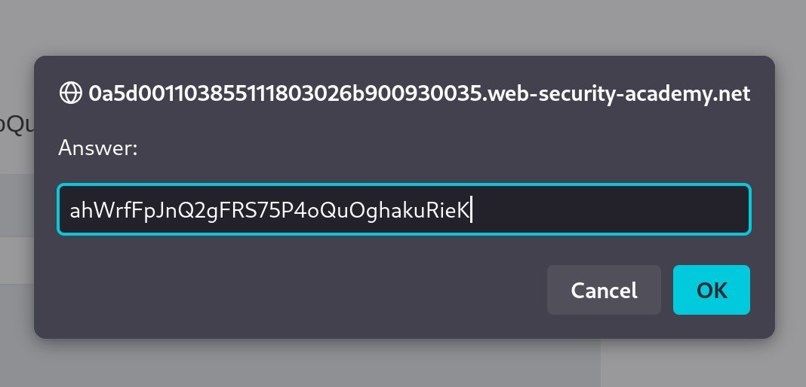
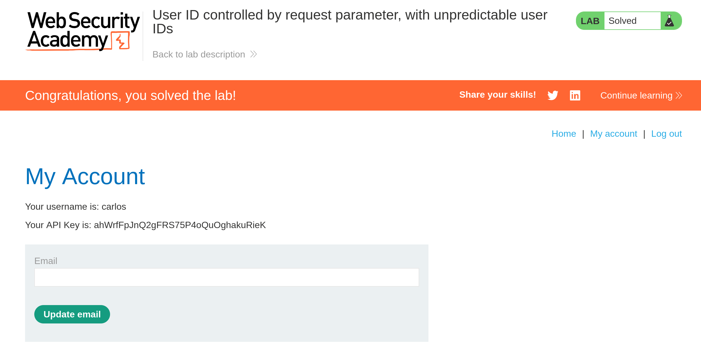

# [PortSwigger] User ID Controlled by Request Parameter, With Unpredictable User IDs - Web Hacking

## 1. 문제 개요

* **문제 링크:** [Web Security Academy - User ID controlled by request parameter, with unpredictable user IDs](https://portswigger.net/web-security/access-control/lab-user-id-controlled-by-request-parameter-with-unpredictable-user-ids)

* **분야:** Web

* **목표:** 계정 페이지에 수평적 권한 상승(IDOR) 취약점이 존재하나 사용자를 GUID로 식별함. 애플리케이션 내에서 `carlos`의 GUID를 수집해 그의 API Key를 탈취하고 이를 제출하여 Lab 해결

## 2. 취약점 분석
소스가 제공되지 않는 접근 통제(수평적 권한 상승) 취약점으로, 계정 페이지와 블로그 기능의 요청/응답 동작을 블랙박스로 관찰해 분석. 계정 페이지(`/my-account`)는 조회 대상을 `id` 파라미터의 GUID로 식별하며, 사용자명과 달리 추측이 어려운 GUID를 쓰는 것만으로 보호를 삼음. 그러나 서버가 세션 소유자와 요청된 GUID의 일치 여부를 검증하지 않고, 더욱이 블로그 게시글의 작성자 링크(`/blogs?userId=<GUID>`)가 해당 작성자의 GUID를 그대로 노출함. 따라서 공격자는 다른 사용자의 GUID를 애플리케이션 내부에서 수집해 `id`에 대입하면 그 사용자의 계정 정보(API Key 포함)를 열람 가능.

* **분석 결론:** 소유자 인가 검증 부재라는 근본 결함에 더해, "추측 불가능한 식별자(GUID)"라는 보호가 식별자 노출(블로그 작성자 링크)로 즉시 무력화. 식별자의 추측 난이도는 접근 통제를 대체할 수 없으며, 수집한 carlos의 GUID로 그의 API Key가 세션 권한과 무관하게 노출됨.

## 3. 공격 수행

1. 메인 페이지 하단의 블로그 게시글 목록을 확인하고, 게시글(View post)에 접근.



2. 게시글(Festivals)에서 작성자가 `carlos`임을 확인하고 작성자 링크에 접근.



3. 작성자 링크 접근 시 URL에 carlos의 GUID가 그대로 노출됨(`/blogs?userId=388c6de3-...`)을 확인하고, 해당 GUID를 확보.



4. `wiener:peter`로 로그인한 계정 페이지의 `id`를 확보한 carlos의 GUID로 변경. 세션 소유자 검증 없이 carlos의 계정 페이지가 로드되며 API Key가 노출됨을 확인.

```http
// [계정 조회 요청] 블로그에서 수집한 carlos의 GUID를 id에 대입 (브라우저 URL)
GET /my-account?id=388c6de3-c776-417d-a70f-0f8c881b2b65
```



5. 노출된 carlos의 API Key를 복사해 Submit solution에 입력·제출.



6. "Congratulations, you solved the lab!" 노출로 Lab 해결을 확인(Render).



## 4. 획득 결과
블로그 게시글의 작성자 링크에서 carlos의 GUID를 수집하고, 계정 페이지의 `id`에 대입해 소유자 인가 검증 부재를 이용, carlos 계정의 API Key를 열람·탈취. 획득한 API Key를 제출해 Lab 해결.

## 5. 대응 방안
조회 대상을 서버 측 세션으로 결정하고 소유자 인가를 강제하며, 내부 식별자 노출을 차단할 필요.

* **세션 기반 자원 식별:** 계정 페이지는 조회 대상을 `id` 파라미터가 아니라 서버가 보관한 세션의 사용자 식별자로 결정. 사용자가 조회 대상을 지정하는 파라미터 자체를 제거.

* **객체 수준 인가 검증(Object-Level Authorization):** 식별자를 입력받는 경우, 자원 접근 전 요청 세션이 해당 자원의 소유자·권한자인지 서버에서 검증하고 미충족 시 차단.

* **내부 식별자 노출 최소화:** 블로그 작성자 링크 등 공개 기능에서 사용자 GUID 같은 내부 식별자를 그대로 노출하지 않음. 추측 불가능한 식별자는 보조적 완화책일 뿐, 노출되면 무의미하므로 근본 해결은 인가 검증.

* **민감 정보 최소 노출:** API Key 등 민감 필드는 소유자 확인이 끝난 경우에만 반환하고, 계정 조회 응답에 불필요하게 포함하지 않음.

## 6. 블루팀 관점 요약
보안관제 및 침해사고 대응(IR) 관점에서, GUID 노출 기반 IDOR은 공개 기능에서 수집한 타 사용자 식별자로 계정 자원을 조회하는 연쇄 흐름으로 식별 가능.

* **WAF 및 웹 서버 로그 분석:** 한 세션이 `/blogs?userId=<GUID>`로 타 사용자 식별자를 조회한 직후 동일 GUID로 `/my-account?id=<GUID>`에 접근하는 교차 흐름, 세션 소유자와 다른 GUID로의 계정 접근, 다수 GUID 순회를 상관 분석해 탐지.

* **침해사고 대응(IR) 시나리오:** 비정상 GUID 접근 로그에서 열람된 타 사용자 자원(API Key 등)의 범위를 산정하고, 유출된 키를 즉시 폐기·회전. 해당 세션·계정·출처 IP를 침해 지표(IoC)로 격리.

* **네트워크 기반 탐지 룰 제안 (Snort 3):**

  - 식별자가 GUID로 가변이고 정상 요청에도 포함되어 고정 시그니처가 약하므로, "세션 소유자 ≠ 요청 `id`" 및 "`/blogs` 식별자 수집 → `/my-account` 교차 접근" 상관 분석을 애플리케이션·로그 레벨에서 수행하는 쪽이 신뢰도가 높음. 네트워크 단에서는 단시간 다수 계정 조회 시도를 보조적으로 탐지.

  - `alert http $EXTERNAL_NET any -> $HTTP_SERVERS any (msg:"[Web] Possible IDOR via GUID on /my-account"; flow:to_server,established; http_uri; content:"/my-account?id="; detection_filter:track by_src, count 15, seconds 10; sid:1000038; rev:1;)`