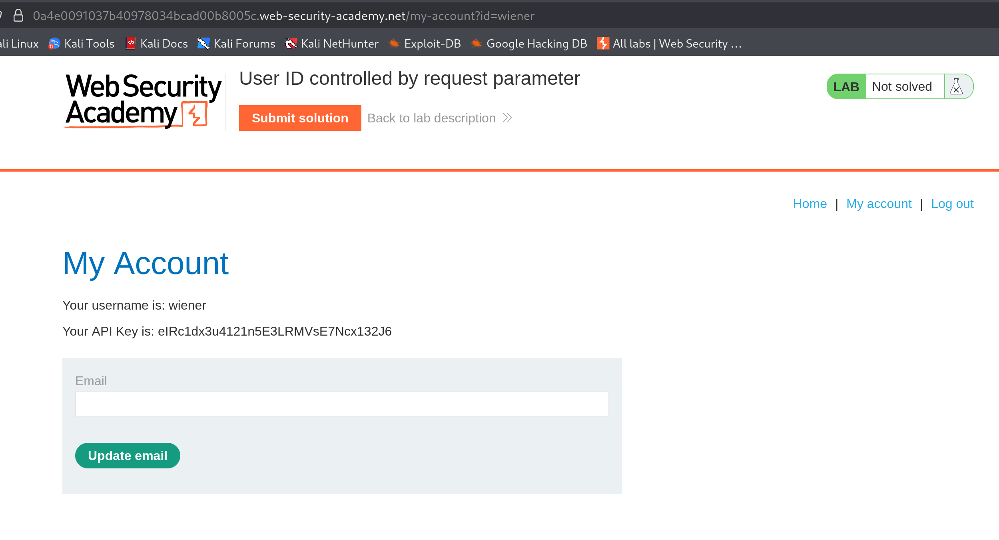
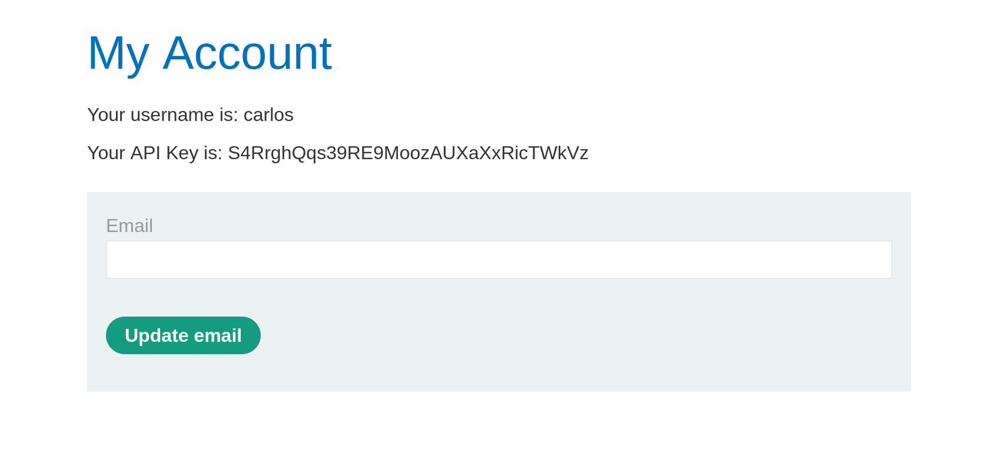
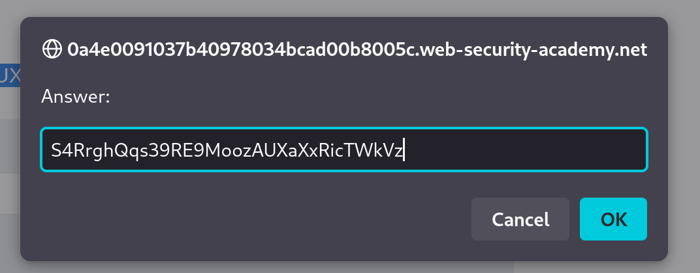
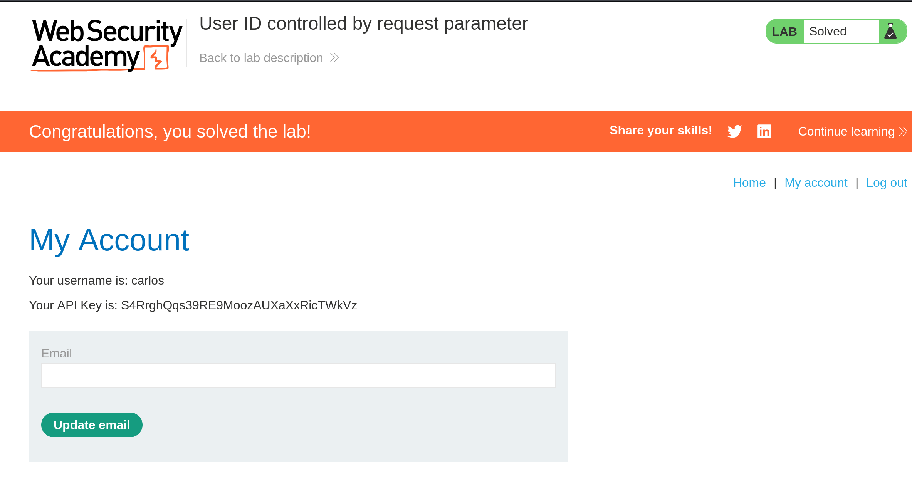

# [PortSwigger] User ID Controlled by Request Parameter - Web Hacking

## 1. 문제 개요

* **문제 링크:** [Web Security Academy - User ID controlled by request parameter](https://portswigger.net/web-security/access-control/lab-user-id-controlled-by-request-parameter)

* **분야:** Web

* **목표:** 계정 페이지에 존재하는 수평적 권한 상승(IDOR) 취약점을 이용해, `wiener:peter`로 로그인한 상태에서 `id` 파라미터를 조작해 사용자 `carlos`의 API Key를 탈취하고 이를 제출하여 Lab 해결

## 2. 취약점 분석
소스가 제공되지 않는 접근 통제(수평적 권한 상승) 취약점으로, 계정 페이지의 요청/응답 동작을 블랙박스로 관찰해 분석. 계정 페이지(`/my-account`)는 조회 대상 사용자를 `id` 쿼리 파라미터(`?id=wiener`)로 식별하는데, 서버가 요청 세션의 소유자와 요청된 `id`가 일치하는지 검증하지 않음. 따라서 로그인한 사용자가 `id` 값을 다른 사용자명으로 바꾸면, 세션 권한과 무관하게 해당 사용자의 계정 정보(API Key 포함)가 그대로 반환됨.

* **분석 결론:** 서버가 인증(로그인)만 요구하고 인가(요청한 자원이 요청자 소유인지)를 검증하지 않아, 클라이언트가 제어하는 `id` 파라미터만 변경하면 임의 사용자의 민감 정보를 열람할 수 있는 수평적 권한 상승(IDOR)이 성립. `id`를 `carlos`로 지정하는 것만으로 carlos의 API Key가 노출됨.

## 3. 공격 수행

1. `wiener:peter`로 로그인한 뒤 My Account에 접근. URL이 `/my-account?id=wiener`로, 계정을 `id` 쿼리 파라미터로 식별하고 있음을 확인.



2. URL의 `id` 파라미터를 `carlos`로 변경해 요청. 세션 소유자 검증 없이 carlos의 계정 페이지가 그대로 로드되며, carlos의 API Key가 노출됨을 확인.

```http
// [계정 조회 요청] id 파라미터를 carlos로 변경 (브라우저 URL)
GET /my-account?id=carlos
```



3. 노출된 carlos의 API Key를 복사해 Submit solution에 입력·제출.



4. "Congratulations, you solved the lab!" 노출로 Lab 해결을 확인(Render).



## 4. 획득 결과
계정 페이지가 조회 대상을 클라이언트 제어 `id` 파라미터로만 식별하고 소유자 인가를 검증하지 않는 결함을 이용해, `id`를 `carlos`로 변경하여 carlos의 계정 페이지에서 API Key를 열람·탈취. 획득한 API Key를 제출해 Lab 해결.

## 5. 대응 방안
조회 대상 자원을 클라이언트 입력이 아니라 서버 측 세션으로 결정하고, 자원 접근 시 소유자 인가를 강제할 필요.

* **세션 기반 자원 식별:** 계정 페이지는 조회 대상을 `id` 파라미터가 아니라 서버가 보관한 세션의 사용자 식별자로 결정. 사용자가 조회 대상을 지정하는 파라미터 자체를 제거.

* **객체 수준 인가 검증(Object-Level Authorization):** 불가피하게 식별자를 입력받는 경우, 자원 접근 전 요청 세션이 해당 자원의 소유자·권한자인지 서버에서 검증하고 미충족 시 차단.

* **민감 정보 최소 노출:** API Key 등 민감 필드는 소유자 확인이 끝난 경우에만 반환하고, 계정 조회 응답에 불필요하게 포함하지 않음.

* **추측 가능한 식별자 지양:** 사용자명처럼 예측 가능한 값 대신 추측이 어려운 식별자를 사용(보조적 완화책이며, 근본 해결은 인가 검증).

## 6. 블루팀 관점 요약
보안관제 및 침해사고 대응(IR) 관점에서, IDOR 기반 수평적 권한 상승은 한 세션이 자신의 식별자가 아닌 다른 사용자 `id`로 계정 자원을 조회하는 흐름으로 식별 가능.

* **WAF 및 웹 서버 로그 분석:** 동일 세션이 로그인 사용자명과 다른 `id` 값으로 `/my-account`에 접근하는 요청, 짧은 시간 내 여러 `id` 값을 순회(열거)하는 패턴을 상관 분석해 탐지. 정상 사용자는 자신의 `id`만 조회함.

* **침해사고 대응(IR) 시나리오:** 비정상 `id` 접근 로그에서 열람된 타 사용자 자원(API Key 등)의 범위를 산정하고, 유출된 키를 즉시 폐기·회전. 해당 세션·계정·출처 IP를 침해 지표(IoC)로 격리.

* **네트워크 기반 탐지 룰 제안 (Snort 3):**

  - `/my-account`는 정상 요청에도 `id` 파라미터가 붙어 네트워크 시그니처만으로는 정상·악성 구분이 어려우므로, "세션 소유자 ≠ 요청 `id`" 상관 분석을 애플리케이션·로그 레벨에서 수행하는 쪽이 신뢰도가 높음. 네트워크 단에서는 단시간 다수 `id` 순회(열거) 시도를 보조적으로 탐지.

  - `alert http $EXTERNAL_NET any -> $HTTP_SERVERS any (msg:"[Web] Possible IDOR Enumeration on /my-account"; flow:to_server,established; http_uri; content:"/my-account?id="; detection_filter:track by_src, count 20, seconds 10; sid:1000036; rev:1;)`