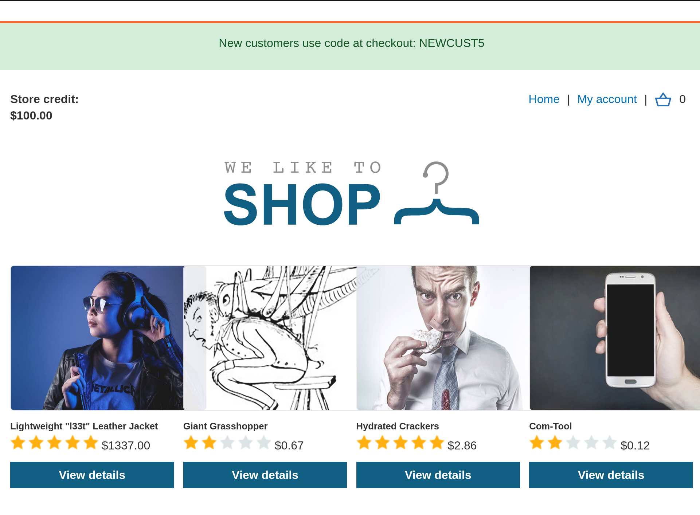
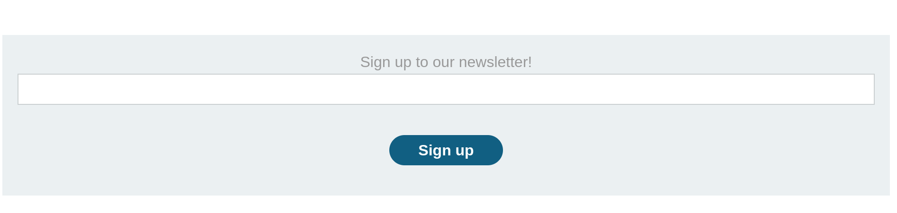
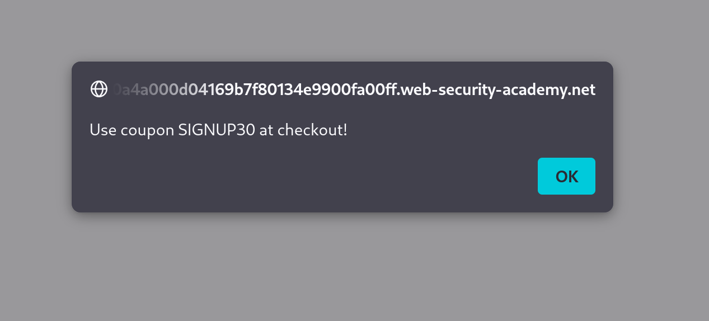
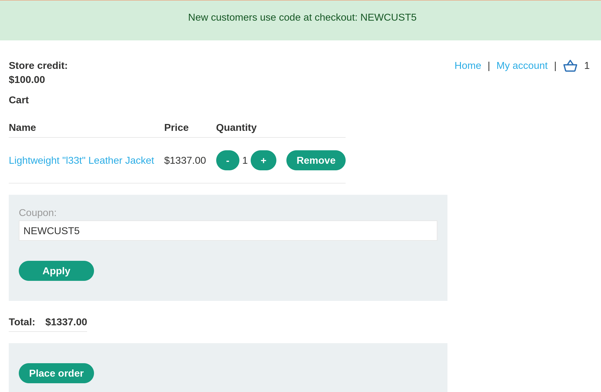
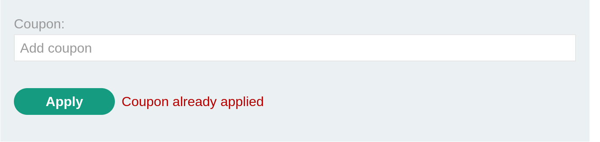
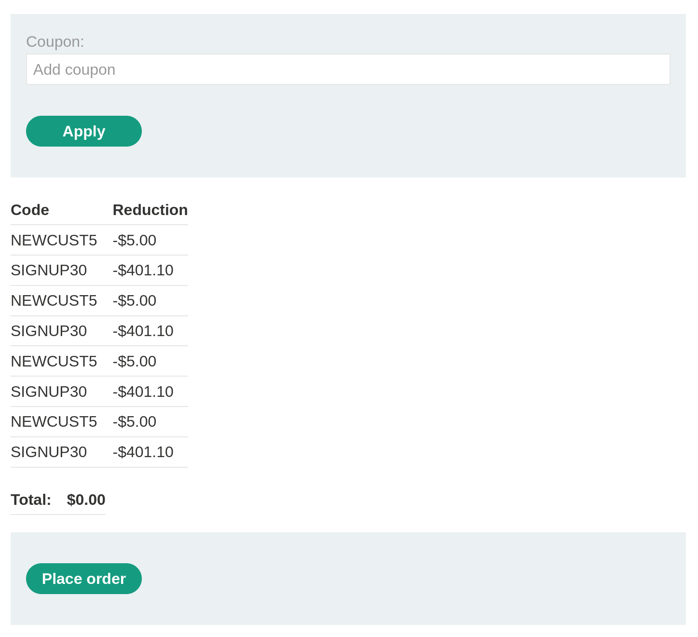
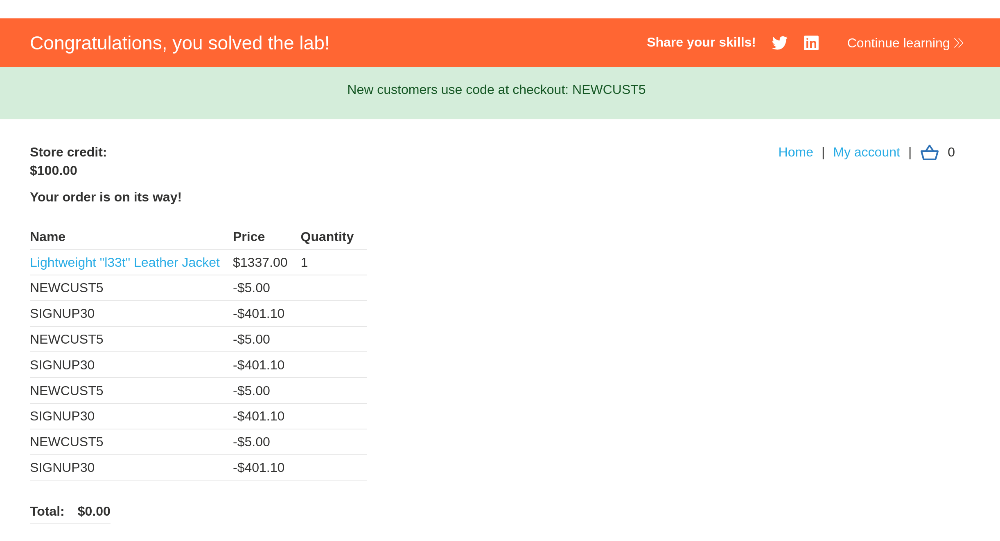

# [PortSwigger] Flawed Enforcement of Business Rules - Web Hacking

## 1. 문제 개요

* **문제 링크:** [Web Security Academy - Flawed enforcement of business rules](https://portswigger.net/web-security/logic-flaws/examples/lab-logic-flaws-flawed-enforcement-of-business-rules)

* **분야:** Web

* **목표:** 구매 워크플로의 쿠폰 처리 로직 결함을 악용해 쿠폰을 중복 적용, 주문 총액을 보유 스토어 크레딧($100) 이하로 낮춰 "Lightweight l33t leather jacket"을 구매하여 Lab 해결

## 2. 취약점 분석
소스가 제공되지 않는 로직 결함 문제로, 쿠폰 할인 처리 동작을 블랙박스로 관찰해 분석. 상점은 신규 고객용 `NEWCUST5`와 뉴스레터 가입 시 제공되는 `SIGNUP30` 두 종류의 쿠폰을 운영하며, 장바구니에서 적용한 쿠폰은 할인액이 누적 반영됨. 동일 쿠폰을 연속으로 재적용하면 "Coupon already applied"로 거부되나, 서로 다른 두 쿠폰을 번갈아 적용하면 거부되지 않는 동작을 확인.

```
// POST /cart/coupon - 쿠폰 적용 요청 본문 (관찰)
coupon=NEWCUST5
coupon=SIGNUP30   // 직전 코드와 달라 중복 검사 통과
coupon=NEWCUST5   // 다시 통과
coupon=SIGNUP30
... (NEWCUST5 / SIGNUP30 교대 반복)
```

* **분석 결론:** 서버가 쿠폰 중복 적용을 차단할 때 이미 적용된 쿠폰 전체 이력이 아니라 직전에 적용된 코드 하나만 비교 대상으로 삼는 것으로 판단. 동일 코드를 연속 입력하면 직전 값과 일치해 거부되지만, 두 코드를 번갈아 입력하면 매 요청이 직전 코드와 달라 중복 검사를 통과함. 여기에 쿠폰별 사용 횟수 제한과 할인 후 총액 하한 검증이 모두 부재해, 두 코드 교대 입력을 반복하는 것만으로 할인을 무제한 누적시켜 총액을 보유 크레딧 이하로 낮출 수 있음.

## 3. 공격 수행

1. 홈 화면 상단 배너에서 신규 고객용 쿠폰 `NEWCUST5`를 확인. 첫 번째 쿠폰 코드로 확보.



2. 페이지 하단 뉴스레터 구독란에 임의 형식 이메일(`test@test`)을 입력해 가입 진행. 도메인·실수신 검증이 없어 아무 형식이나 통과.



3. 가입 직후 두 번째 쿠폰 코드 `SIGNUP30`을 획득. 할인 누적에 사용할 두 번째 코드 확보.



4. 재킷을 장바구니에 담고 쿠폰란에 `NEWCUST5`를 적용.



5. 동일 코드를 연속으로 재입력해 중복 차단 동작을 먼저 확인. "Coupon already applied"로 거부되는 것을 확인해, 중복 검사가 직전 코드 기준임을 역으로 판단.



6. `NEWCUST5`와 `SIGNUP30`을 번갈아 반복 입력해 중복 검사를 우회, 할인을 누적시켜 Total을 $0.00까지 하락시킴.



7. Place order로 주문 완료. "Congratulations, you solved the lab!" 노출로 Lab 해결 확인(Render).



## 4. 획득 결과
홈 배너의 `NEWCUST5`와 뉴스레터 가입으로 얻은 `SIGNUP30` 두 코드를 교대로 반복 입력해 쿠폰 중복 검사를 우회. 할인을 무제한 누적시켜 $1337 재킷의 주문 총액을 $0.00까지 낮춘 뒤 보유 스토어 크레딧($100)으로 결제를 완료하여 Lab 해결.

## 5. 대응 방안
쿠폰 중복·남용 차단을 직전 입력값 비교 같은 부분적 통제가 아닌, 서버가 관리하는 사용 이력과 금액 검증으로 일관되게 처리할 필요.

* **쿠폰 사용 이력 전수 대조:** 중복 여부를 직전에 적용된 코드 하나가 아니라 해당 세션·장바구니에 이미 적용된 쿠폰 전체 집합과 대조하여 판단. 적용된 코드는 집합(Set)에 저장하고 신규 적용 시 포함 여부를 검사.

* **쿠폰별 사용 횟수 제한:** 각 쿠폰에 주문·계정 단위 사용 한도(통상 1회)를 서버에서 부여하고, 한도 초과 적용을 거부하도록 강제.

* **할인 총액 경계 검증:** 쿠폰 적용 후 주문 총액이 0 미만이 되거나 상품 합계 이상으로 할인되지 않도록 서버에서 하한·상한을 검증.

* **최종 금액 서버 재계산:** 결제 시점에 클라이언트가 누적한 할인값을 신뢰하지 않고, 적용된 쿠폰 목록을 서버가 쿠폰 정책에 따라 재적용하여 최종 결제 금액을 다시 산정.

## 6. 블루팀 관점 요약
보안관제 및 침해사고 대응(IR) 관점에서, 쿠폰 중복 적용 남용은 단일 세션에서 쿠폰 적용 엔드포인트로의 반복 요청과 비정상적으로 낮은 결제 금액이 연쇄되는 흐름으로 식별 가능.

* **WAF 및 웹 서버 로그 분석:** 동일 세션(쿠키) 기준으로 `POST /cart/coupon` 요청이 짧은 시간에 다수 발생하고, 전송된 `coupon` 값이 소수의 코드 사이를 교대로 반복한 뒤 주문(`POST /cart`)으로 이어지는 시퀀스를 상관 분석해 탐지. 정상 사용자는 쿠폰 적용 요청이 1~2회에 그침.

* **침해사고 대응(IR) 시나리오:** 상품 합계 대비 과도하게 낮거나 0원에 가까운 결제 주문을 기준으로 역추적. 해당 주문 세션의 쿠폰 적용 요청 횟수와 코드 조합을 확인해, 동일 코드가 이력 집합상 중복 적용된 주문을 쿠폰 남용 건으로 식별.

* **네트워크 기반 탐지 룰 제안 (Snort 3):**

  - 단일 출발지에서 쿠폰 적용 엔드포인트로의 반복 POST가 임계치를 초과하는 레이트 기반 패턴을 탐지. 개별 요청은 정상이나 짧은 시간 내 반복 적용이 남용 신호가 됨.

  - `alert http $EXTERNAL_NET any -> $HTTP_SERVERS any (msg:"[Web] Repeated Coupon Application - Coupon Reuse Abuse"; flow:to_server,established; http_method; content:"POST"; http_uri; content:"/cart/coupon"; detection_filter:track by_src, count 8, seconds 20; sid:1000025; rev:1;)`