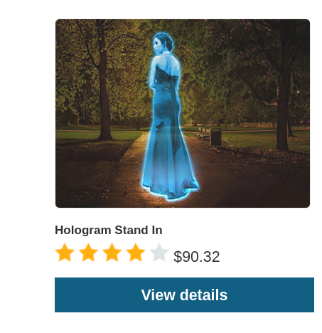
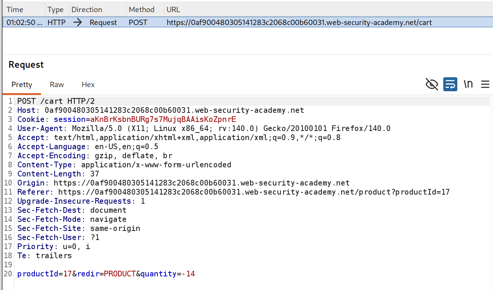
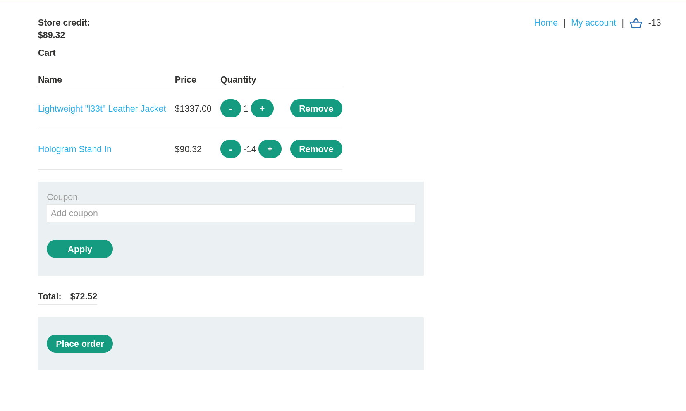
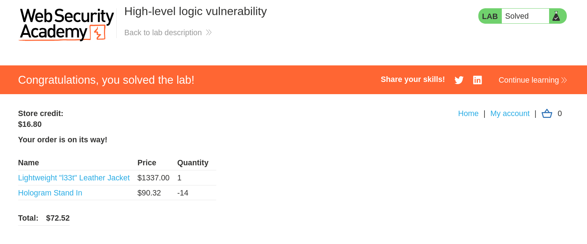

# [PortSwigger] High-level logic vulnerability - Web Hacking

## 1. 문제 개요

* **문제 링크:** [Web Security Academy - High-level logic vulnerability](https://portswigger.net/web-security/logic-flaws/examples/lab-logic-flaws-high-level)

* **분야:** Web

* **목표:** 구매 워크플로우의 로직 결함을 이용해 "Lightweight l33t leather jacket"을 의도되지 않은 가격에 구매하여 Lab 해결

## 2. 취약점 분석
장바구니 담기(`POST /cart`) 요청은 상품 수량을 클라이언트가 보내는 `quantity` 파라미터로 받으며, 주문 총액은 담긴 각 상품의 (단가 × 수량) 소계를 합산해 산출되는 구조. 서버는 이 `quantity` 값을 양의 정수로만 가정할 뿐, 부호를 재검증하지 않음.

```
// POST /cart - 장바구니 담기 요청 본문 구조 (관찰)
productId=1&redir=PRODUCT&quantity=1
```

음수 수량이 전달되면 해당 상품의 소계가 음수로 계산되어 전체 총액을 끌어내리는 동작을 확인. 보유 잔액(Store credit) $89.32로는 $1337.00짜리 재킷을 정상 결제할 수 없으나, 음수 소계로 총액을 잔액 이하로 맞추면 결제가 성립됨.

* **분석 결론:** 주문 총액 검증이 "수량은 양수"라는 클라이언트 신뢰에 의존하는 구조이므로, 별도 상품을 음수 수량으로 담아 음수 소계를 만들면 재킷을 포함한 총액을 잔액 이하로 낮춰 우회 결제가 가능함을 판단.

## 3. 공격 수행


1. 상점 메인에서 보유 잔액 $89.32와 목표 상품 Lightweight l33t Leather Jacket의 정상가 $1337.00을 확인. 잔액이 상품가를 크게 밑돌아 정상 결제가 불가능한 상태 확인.


2. 총액 상쇄에 사용할 상품으로 Hologram Stand In($90.32)을 선정. 단가가 충분히 커서 적은 수량으로도 재킷 가격을 상쇄 가능.



3. 상쇄용 상품의 `POST /cart` 요청을 Burp Proxy로 포착 후, `quantity` 값을 음수(`-14`)로 변조하여 전송. 재킷은 수량 1로 정상 담은 상태 유지.

```
// POST /cart - 변조한 요청 본문
productId=17&redir=PRODUCT&quantity=-14
```



4. 장바구니에서 Hologram Stand In이 -14개로 반영되어 소계 -$1264.48이 적용되고, 재킷 $1337.00과 합산되어 Total이 $72.52로 잔액 $89.32 이하로 내려간 것을 확인.



5. Place order로 주문 진행. 총액 $72.52가 잔액 내에서 결제 처리되며 "Congratulations, you solved the lab!" 노출로 Lab 해결 확인(Render).



## 4. 획득 결과
상쇄용 상품을 음수 수량으로 담아 총액을 보유 잔액 이하로 조정, 재킷을 포함한 주문을 $72.52에 처리하여 Lab 해결. 결제 후 잔액은 $89.32에서 $16.80으로 차감되어 주문 성립을 확인.

## 5. 대응 방안
수량·금액 등 주문 성립에 직결되는 값을 클라이언트 입력에 의존하지 않고, 서버가 정상 범위와 불변식을 강제하는 구조로 전환할 필요.

* **수량 입력값 검증:** `quantity`를 서버에서 1 이상의 정수로 강제하고, 음수·0·비정수 요청은 거부. 상품당 최대 수량 상한도 서버에서 적용.

* **주문 금액 서버 재계산:** 각 상품 소계와 총액을 `productId` 기준 서버 단가로 재계산하고, 소계가 음수가 되는 경우를 원천 차단.

* **결제 전 불변식 검증:** 결제 직전 총액이 0 이상이며 보유 잔액 이하라는 조건뿐 아니라, 모든 상품 소계가 양수라는 불변식을 함께 검증해 우회 조합을 차단.

* **클라이언트-서버 책임 분리:** 클라이언트는 수량 입력·표시만 담당하고, 금액 산출·잔액 판정 등 비즈니스 로직은 전적으로 서버에서 처리하도록 설계.

## 6. 블루팀 관점 요약
보안관제 및 침해사고 대응(IR) 관점에서, 음수 수량을 이용한 로직 우회는 주문 요청 본문과 거래 로그의 비정상 값으로 식별 가능.

* **WAF 및 웹 서버 로그 분석:** `POST /cart` 등 주문 관련 엔드포인트의 요청 본문에서 `quantity` 파라미터가 음수로 전송되는 요청 식별. 동일 세션 내에서 음수 수량 담기 직후 결제가 성립되는 패턴을 상관 분석해 탐지.

* **침해사고 대응(IR) 시나리오:** 주문/결제 로그에서 상품 소계가 음수로 기록되었거나 총액이 개별 상품 정상가 합보다 비정상적으로 낮은 거래를 역추적, 해당 세션의 `POST /cart` 요청 원문에서 음수 `quantity` 값과 변조 시점 확인.

* **네트워크 기반 탐지 룰 제안 (Snort 3):**

  - `/cart` 요청 본문에 `quantity` 파라미터가 음수 부호(`-`)를 포함해 전송되는 패턴 탐지.

  - `alert http $EXTERNAL_NET any -> $HTTP_SERVERS any (msg:"[Web] Negative Quantity in Cart Request"; flow:to_server,established; http_uri; content:"/cart"; http_client_body; content:"quantity=-"; sid:1000023; rev:1;)`