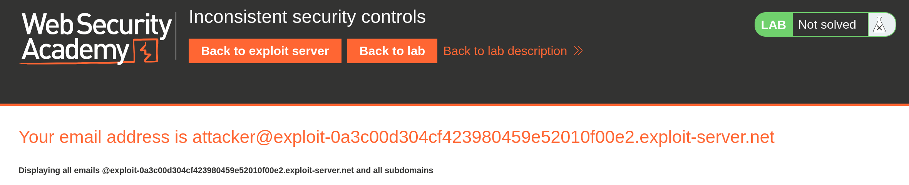
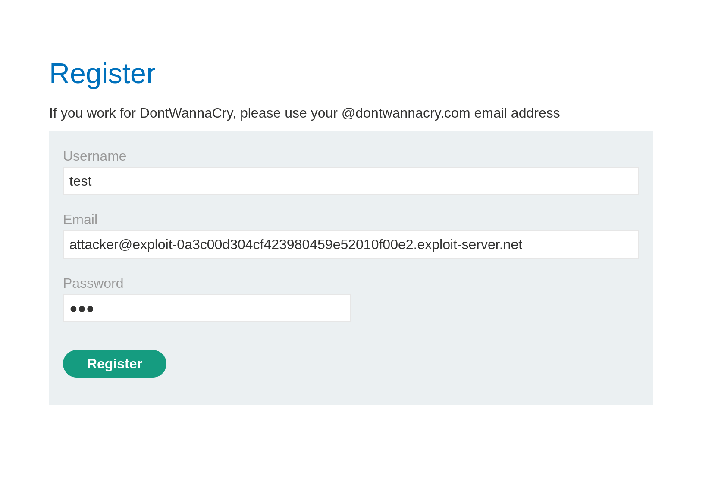
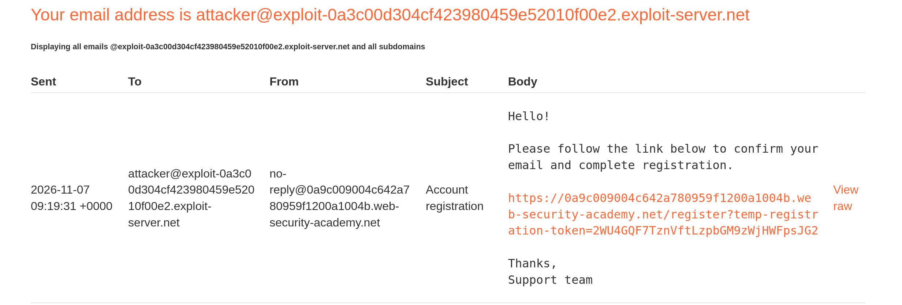
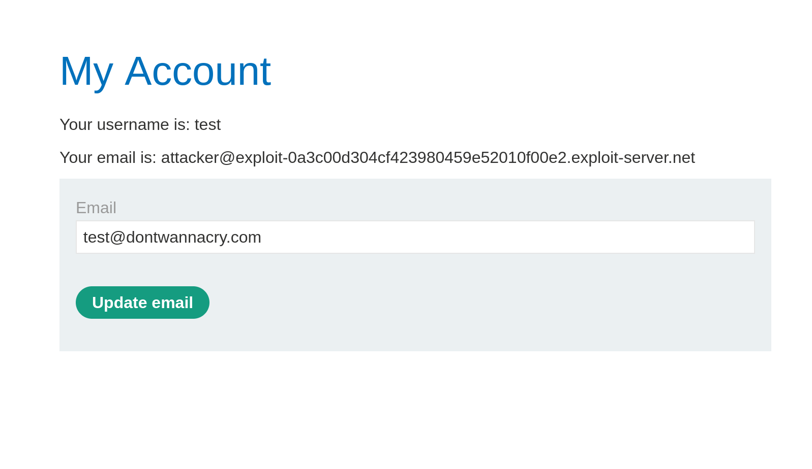
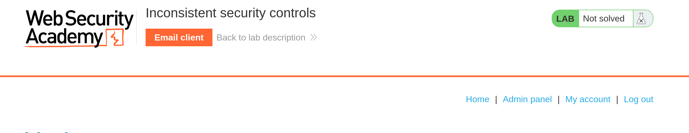
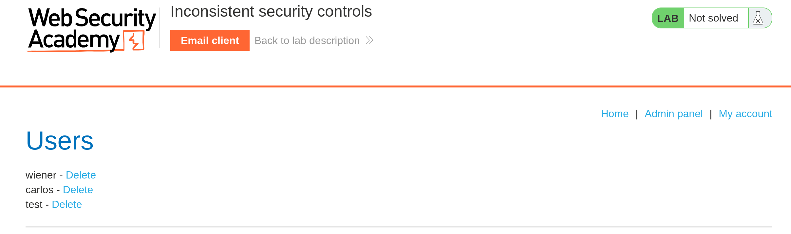
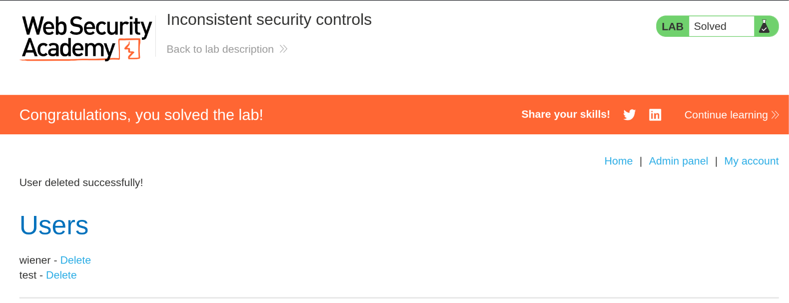

# [PortSwigger] Inconsistent security controls - Web Hacking

## 1. 문제 개요

* **문제 링크:** [Web Security Academy - Inconsistent security controls](https://portswigger.net/web-security/logic-flaws/examples/lab-logic-flaws-inconsistent-security-controls)

* **분야:** Web

* **목표:** 직원 전용으로 제한되어야 할 관리자 기능에 임의 사용자가 접근하는 결함을 이용해 관리자 패널에 접근하고 사용자 `carlos`를 삭제하여 Lab 해결

## 2. 취약점 분석
회원가입 페이지는 `@dontwannacry.com` 도메인 이메일로 가입한 사용자를 사내 직원으로 간주하고 관리자 패널 접근 권한을 부여하는 구조. 가입(register) 시점에는 이메일로 발송되는 인증 링크를 통과해야 계정이 활성화되므로 실제 수신 가능한 주소만 등록 가능한 반면, 가입 이후 My account의 이메일 변경(update email) 기능에는 도메인 검증이 적용되지 않아 활성화된 계정의 이메일을 임의 도메인으로 변경할 수 있음.

```
// POST /my-account/change-email - 이메일 변경 요청 본문 (관찰)
email=test@dontwannacry.com
```

* **분석 결론:** 관리자 권한 판별이 "현재 계정의 이메일 도메인이 `@dontwannacry.com`인가"라는 변경 가능한 사용자 속성에 의존하는데, 이 도메인 검증이 가입 시점에는 적용되고 이메일 변경 시점에는 누락되어 두 경로의 통제 수준이 불일치(inconsistent)함을 판단. 공격자가 통제 가능한 외부 메일 주소로 계정을 먼저 활성화한 뒤 이메일을 `@dontwannacry.com`으로 변경하면 직원 판별을 충족시켜 관리자 패널 접근이 가능함.

## 3. 공격 수행

1. Exploit server의 Email client에서 공격자가 수신 가능한 메일 주소(`attacker@exploit-...exploit-server.net`)를 확인. 가입 인증 메일을 실제로 수신하기 위한 통제 가능 주소로 사용.



2. 확인한 exploit-server 주소를 Email에 입력해 가입 진행. 가입 단계의 도메인 검증을 우회하지 않고, 수신 가능한 주소로 정상 가입 절차를 밟아 인증 메일을 유도.



3. Email client로 수신한 Account registration 메일의 인증 링크(`/register?temp-registration-token=...`)에 접속해 계정을 활성화.



4. 활성화된 계정으로 로그인 후 My account의 이메일 변경 기능에서 Email을 `test@dontwannacry.com`으로 변경. 변경 경로에는 도메인 검증이 없어 직원 도메인으로의 임의 변경이 성립.



5. 이메일 변경 직후 상단 메뉴에 Admin panel 링크가 노출된 것을 확인. 현재 이메일 도메인 기준으로 직원 판별이 통과되어 관리자 기능이 활성화됨.



6. Admin panel의 Users 목록에서 대상 사용자 `carlos`의 Delete를 실행.



7. "User deleted successfully!" 및 "Congratulations, you solved the lab!" 노출로 Lab 해결 확인(Render).



## 4. 획득 결과
수신 가능한 외부 메일 주소로 계정을 활성화한 뒤, 도메인 검증이 누락된 이메일 변경 기능으로 계정 이메일을 `@dontwannacry.com`으로 변경하여 직원 판별을 충족. 관리자 패널에 접근해 사용자 `carlos`를 삭제하여 Lab 해결.

## 5. 대응 방안
직원·관리자 권한 판별을 변경 가능한 사용자 속성에 의존하지 않고, 권한에 직결되는 검증을 모든 진입 경로에 일관되게 적용하는 구조로 전환할 필요.

* **권한 판별 기준 분리:** 직원 여부를 이메일 도메인 같은 사용자 수정 가능 값이 아닌, 서버가 관리하는 역할(role) 속성으로 판별. 사용자는 자신의 role을 변경할 수 없도록 설계.

* **검증 로직 공통화:** 이메일 도메인 검증이 필요하다면 가입·이메일 변경 등 이메일을 설정하는 모든 엔드포인트가 동일한 검증 함수를 공유하도록 하여 경로별 통제 불일치를 제거.

* **이메일 변경 재검증:** 이메일 변경 요청 시에도 가입과 동일하게 도메인 정책을 적용하고, 변경 후 재인증(확인 메일 발송)을 거치도록 하여 임의 도메인으로의 무검증 변경을 차단.

* **민감 권한 변경 시 재평가:** 이메일 등 권한 판별에 쓰이는 속성이 변경될 경우 해당 세션의 권한을 즉시 재평가하여, 속성 변경만으로 관리자 권한이 자동 승격되지 않도록 설계.

## 6. 블루팀 관점 요약
보안관제 및 침해사고 대응(IR) 관점에서, 이메일 변경을 통한 권한 우회는 계정 활성화 이후 직원 도메인으로의 이메일 변경과 관리자 엔드포인트 접근이 연쇄되는 비정상 흐름으로 식별 가능.

* **WAF 및 웹 서버 로그 분석:** 외부 도메인으로 가입·활성화된 계정이 이후 `POST /my-account/change-email`로 사내 도메인(`@dontwannacry.com`)으로 이메일을 변경하고, 곧바로 `/admin` 등 관리자 엔드포인트에 접근하는 요청 시퀀스를 동일 세션 단위로 상관 분석해 탐지.

* **침해사고 대응(IR) 시나리오:** 관리자 기능(사용자 삭제 등) 수행 계정을 역추적해, 해당 계정의 이메일이 외부 도메인에서 사내 도메인으로 변경된 이력과 변경 시점을 확인. 정규 직원 계정 발급 절차를 거치지 않고 이메일 변경만으로 사내 도메인을 획득한 계정을 침해 계정으로 식별.

* **네트워크 기반 탐지 룰 제안 (Snort 3):**

  - 이메일 변경 요청 본문에 사내 도메인(`dontwannacry.com`)이 포함되어 전송되는 패턴 탐지. 정규 직원 가입 경로가 아닌 변경 경로에서의 사내 도메인 설정 시도를 포착.

  - `alert http $EXTERNAL_NET any -> $HTTP_SERVERS any (msg:"[Web] Employee Domain Set via Email Change"; flow:to_server,established; http_uri; content:"/my-account/change-email"; http_client_body; content:"dontwannacry.com"; sid:1000024; rev:1;)`